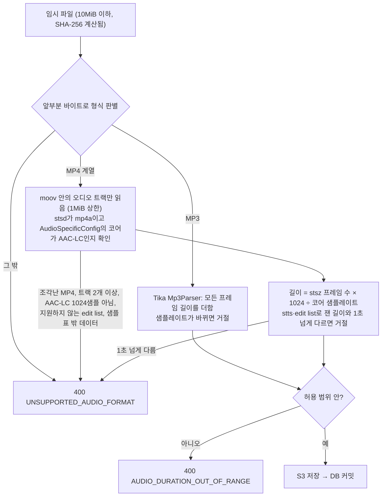

# ADR: 곡 업로드와 형식·길이 검사

- 상태: **Proposed** (PR 리뷰에서 확정)
- 결정일: **2026-10-20** (NSU-89 설계 세션 `51255b80`, NSU-48·89 설계 세션)
- 관련: [04 곡 API §2](../../api/04_music.md), [01 곡 권리 검증](./01_music_rights_verification.md), SSOT `AI-032`~`AI-034`·`AI-038`·`STORAGE-101`~`103`, 서버 협의 001·002·003·013·015, NSU-89·103

---

## Decision

**ARTIST가 올린 곡을 Spring이 검사해 저장한다. 길이는 파일 머리말이 아니라 실제 오디오 프레임으로 잰다.**

| 항목 | 결정 |
|---|---|
| 범위 | 새 곡 업로드만 한다. 원본 교체·삭제는 NSU-103이다(`51255b80` 질문 1) |
| 저장 구조 | 곡 테이블 `music`과 revision 테이블 `music_audio_revisions`로 나눈다. revision 행 하나가 파일 하나다(`51255b80` 질문 3·6) |
| 곡 수 | 아티스트당 삭제하지 않은 곡 최대 3개(`51255b80` 질문 5) |
| 저장소 | S3 비공개 버킷의 `private/ai-samples/`(`51255b80` 질문 7, `STORAGE-103`) |
| 저장 순서 | 검사 → S3 저장 → DB 커밋(`51255b80` 질문 8). S3 저장은 업로드 트랜잭션 안에서 하고, 트랜잭션 수명은 PostgreSQL `transaction_timeout`(기본 2분)으로 DB가 강제한다. S3 원본은 커밋되지 않은 것이 확실할 때만 바로 지운다. 커밋 결과를 모르면 남기고, NSU-103의 정리 작업이 revision이 가리키지 않고 정리 유예(기본 1시간, 트랜잭션 수명보다 길게)가 지난 것을 확인한 뒤 지운다 |
| 형식 | MP3, 또는 AAC를 담은 M4A. AAC는 코어가 AAC-LC이고 프레임이 1024샘플인 구성만 받는다(HE-AAC·HE-AACv2 포함). 샘플 표가 가리키지 않는 데이터가 있으면 거절한다. 10MiB 이하. 파일 내용으로 판별한다 |
| 길이 측정 | MP3는 Tika `Mp3Parser`로 프레임 길이를 더한다. M4A는 오디오 트랙의 표를 직접 읽어 AAC 프레임 수 × 1024 ÷ 코어 샘플레이트로 잰다. 코어 샘플레이트는 `esds`의 AudioSpecificConfig에서 읽는다 |
| 길이 범위 | 설정값. 지금은 SSOT `AI-033`의 60~80초(경계 포함). AI 담당이 동의하면 56~60초 |
| 다시 보낸 업로드 | 같은 아티스트의 같은 파일(SHA-256)이면 새 곡을 만들지 않는다. `Idempotency-Key` 헤더는 받지 않는다. 권리 중단 기록이 남은 파일은 곡을 지운 뒤에도 거절한다([01](./01_music_rights_verification.md)) |
| 업로드 입력 | 음원, 제목, 커버곡 여부, KOMCA·KOSCAP 신탁 여부(자기 신고), 권리 보증과 화면이 보여 준 보증 문구 버전 |

**직접 읽는 M4A 코드의 안전장치**

- 지원 범위를 좁히고, 그 밖은 모두 거절한다(fail closed). 조각난 MP4(`moof`), 오디오 트랙이 2개 이상인 파일, AAC가 아닌 코덱(ALAC 등), 코어가 AAC-LC가 아니거나 프레임이 1024샘플이 아닌 AAC(960샘플 구성, AAC-LD·ELD 등)다.
- 샘플 표가 가리키지 않는 데이터를 받지 않는다. `mdat`은 1개다. 샘플 표(`stsc`·`stco`/`co64`·`stsz`)로 각 샘플의 위치와 크기를 계산해 오프셋 순으로 놓았을 때, `mdat` 본문을 빈틈·겹침 없이 정확히 채워야 한다. `moov`·`mdat` 밖의 최상위 상자는 합쳐서 64KiB(설정값) 이하다.
- 재생 구간 표(edit list, `edts`·`elst`)는 항목 1개, 일반 재생(`media_time ≥ 0`, `media_rate = 1`)이고 그 구간 길이가 프레임으로 잰 길이와 1초(설정값) 안에서 같을 때만 받는다. 구간 반복, 빈 구간, 속도 변경, 크게 잘라 내기는 거절한다.
- 상자(box) 크기를 믿지 않는다. 파일 크기를 넘는 크기, 음수·0 크기는 거절한다. `moov`는 1MiB 이하만 읽는다. 60초 AAC의 프레임 표는 약 11KB다.
- 읽는 상자 수와 처리 시간에 상한을 둔다.
- 측정은 인터페이스 뒤에 둔다. 나중에 별도 미디어 작업 서버로 옮길 수 있게 하기 위해서다.

**업로드 메모리 규칙**

| 규칙 | 설정·방법 |
|---|---|
| 업로드 파일을 힙에 올리지 않는다 | `spring.servlet.multipart.file-size-threshold: 0B`(기본값). `MultipartFile.getBytes()`를 쓰지 않는다 |
| 크기 상한 | `max-file-size: 10MB`(Spring의 MB는 MiB, 10,485,760바이트), `max-request-size: 11MB`(텍스트 파트와 multipart 경계 포함) |
| 임시 파일 | `MultipartFile.transferTo(Path)`로 권한·용량을 제한한 임시 경로에 옮기고, 처리가 끝나면 `finally`에서 지운다 |
| S3 전송 | `RequestBody.fromFile(Path)`로 보낸다. 파일 전체를 힙에 올리지 않는다 |
| 앞단 | 프록시(ALB·nginx)에도 본문 크기 상한을 둔다. `Content-Length`만 믿지 않고 실제 받은 양으로도 끊는다 |
| 동시성 | 동시 업로드 수에 상한을 둔다 |

## Context

- 서버 협의 013(Proposed)은 "Backend가 형식(확장자가 아닌 파일 내용)·크기·길이를 검사한다"고 제안한다. AI도 디코딩하면서 길이를 다시 검사한다.
- Spring이 원본을 저장하고 재생 주소를 내준다(02 §2.5). 그래서 저장하고 내보내는 파일이 길이 정책을 지키는지는 Spring이 보장한다.
- 파일 머리말에 적힌 길이는 위조할 수 있다. 3분짜리 AAC(128kbps)는 약 2.9MB라 10MiB 제한에 걸리지 않는다. 머리말만 "58초"로 고치면 3분짜리 곡이 통과한다.
- 압축 파일 크기 제한은 디코딩한 소리의 크기를 제한하지 않는다. 8kbps MP3라면 10MiB가 약 2.8시간이고, 48kHz 모노 float32로 디코딩하면 약 1.9GB다. Spring은 디코딩하지 않으므로 이 문제가 없다. 디코딩하는 쪽(AI)은 디코딩 길이에 따로 상한을 둬야 한다.
- KOMCA 음악저작물 사용료 징수규정 제23조 제5항(2026-08-14 변경본)은 무료 홍보용 스트리밍의 사용료 면제를 한 곡당 30초, 협의하면 60초 이내로 둔다. 60~80초 샘플은 이 상한을 넘는다. 그래서 길이를 56~60초로 줄이는 제안을 AI 담당에게 보냈다(2026-10-20 Slack). AI 분석은 지금도 처음 56초(7초 × 8 Chunk)만 쓴다(`AI-033`).

## Rationale

### 길이를 재는 방법 비교

| 관점 | MP3는 Tika, M4A는 직접 (채택) | MP3·M4A 모두 직접 | Spring에서 ffprobe | AI가 최종 판정 |
|---|---|---|---|---|
| 정확성 | 프레임 기준. 머리말 위조에 속지 않는다. MP3의 예외 상황(ID3 태그, Xing 프레임)은 검증된 Tika 코드가 처리한다 | 프레임 기준. MP3 예외 상황을 직접 처리해야 해 버그 위험이 있다 | 가장 정확하다 | 실제 디코딩 결과라 가장 정확하다 |
| 보안 | Java(메모리 안전). `Mp3Parser`를 직접 불러 다른 파서가 돌지 않는다 | Java. 코드가 작고 통제된다 | DB·JWT·S3 자격증명을 가진 API 서버에서 C로 된 파서가 신뢰할 수 없는 파일을 읽는다 | Spring은 앞부분 바이트만 읽는다 |
| 성능 | 10MiB를 한 번 훑는다. ms 단위다 | 같다 | 업로드마다 프로그램 실행 비용이 든다 | Spring 요청은 빨리 끝난다. 판정은 비동기다 |
| 메모리 | 머리말·표만 읽어 일정하다 | 같다 | 프로세스마다 JVM 밖 메모리를 써서 컨테이너 한도에 함께 잡힌다 | Spring은 거의 쓰지 않는다 |
| 확장성 | 측정이 인터페이스 뒤에 있어 미디어 작업 서버로 옮길 수 있다 | 같다 | 형식 추가·잘라내기·변환에 가장 유리하다 | 이미 비동기다 |
| 운영 | Maven 의존성만 는다 | 의존성이 없다 | Docker 이미지·CI에 FFmpeg를 넣고 관리해야 한다 | 013 변경과 AI 합의가 필요하다 |
| 사용자 경험 | 바로 오류를 준다 | 같다 | 같다 | 길이 오류를 처리 뒤에야 알린다 |
| 구현량 | M4A 표 읽기와 테스트 파일 | 가장 많다 | 적다 | Spring은 적다 |

- **AI 최종 판정을 쓰지 않은 이유**: 원본을 저장하고 내보내는 책임이 Spring에 있다. 그 책임을 AI에 넘기면 저장소와 재생 정책의 보장 주체가 갈린다. 사용자가 이 방향을 택했고, 013 변경 요청은 철회했다.
- **ffprobe를 쓰지 않은 이유**: 정확도는 가장 좋지만, 네이티브 파서가 API 서버에서 돈다. FFmpeg는 취약점 이력이 많고, HLS·concat 같은 입력 형식을 거쳐 다른 로컬 파일을 읽는 공격도 있다. 실서비스에서 잘라내기·변환이 필요해지면 격리된 미디어 작업 서버에 둔다.

### M4A는 머리말이 아니라 프레임 표로 잰다

Tika `MP4Parser`는 길이를 영화 머리말(`mvhd`)의 값으로 읽고, 코덱 칸에 파일 종류 표시(`M4A `)를 넣는다(Tika 소스로 확인). 그래서 코덱이 AAC인지 알 수 없고, 머리말을 고친 파일에 속는다.

플레이어는 샘플 표에 적힌 프레임을 재생 구간 표(edit list)대로 재생한다. 그래서 프레임 수로 잰 길이는 시간 표(`stts`)를 속여도 속지 않는다. 시간 표로 잰 길이(`stts` 합 ÷ `mdhd` 시간 단위)와 1초(설정값) 넘게 다르면 손상되거나 조작된 파일로 보고 거절한다.

재생 구간 표는 재생 길이를 바꿀 수 있다. 같은 구간을 두 번 재생하게 하면 70초 프레임이 140초로 재생되고, 3분 프레임을 70초만 재생하게 자를 수도 있다([Apple QuickTime 명세, Playing with edit lists](https://developer.apple.com/documentation/quicktime-file-format/playing_with_edit_lists)). 자르는 경우에도 파일에는 3분이 들어 있어, 재생 주소로 받은 사람은 3분을 들을 수 있다. 그래서 재생 구간 표는 인코더가 앞쪽 무음 샘플(AAC priming, 보통 2112샘플)을 잘라 내려고 넣는 항목 1개만 받는다. 구간 길이는 `segment_duration` ÷ `mvhd` 시간 단위로 잰다. `mvhd`의 길이 값은 믿지 않고 시간 단위만 쓴다.

샘플 표가 가리키지 않는 데이터도 같은 문제다. 샘플 표가 앞 70초만 가리키게 줄이고 `mdat`에 3분을 남기면, 프레임·시간 표·재생 구간이 모두 70초로 맞는다. 하지만 원본 파일에는 3분이 들어 있다([Apple QuickTime 명세, Sample table atoms](https://developer.apple.com/documentation/quicktime-file-format/sample_table_atom)). 그래서 `mdat`은 1개이고, 샘플들이 `mdat` 본문을 빈틈·겹침 없이 채워야 하며, 다른 최상위 상자는 합쳐서 64KiB 이하여야 한다. 크기 합만 비교하면 청크 오프셋(`stco`)을 겹치게 고쳐, 크기 합은 같게 두고 일부를 비울 수 있다(커밋 리뷰 2026-10-21). 오디오 트랙이 하나뿐이라 FFmpeg·Apple이 만든 정상 파일은 샘플이 `mdat`에 이어 붙어 있어 이 조건을 지킨다.

형식 검사로 막지 못하는 경우가 남는다.

| 숨기는 방법 | 형식 검사로 막는가 |
|---|---|
| 샘플 표 밖에 남긴 데이터, 겹친 청크 | 막는다(위 조건) |
| 샘플 크기를 실제 프레임보다 크게 적어 샘플 안에 넣은 여분 바이트 | 못 막는다. 프레임마다 AAC 비트스트림을 해석해야 한다 |
| `moov` 안 메타데이터(표지 그림 등), MP3의 ID3 태그 | 못 막는다. `moov` 1MiB 상한으로 양만 줄인다 |

남은 경우는 일반 플레이어로 재생되지 않고, 꺼내려면 별도 도구가 필요하다. 그래서 MVP에서는 받아들인다. 확실히 막으려면 파일을 다시 인코딩해 오디오만 남겨야 하므로, 상용화 전 미디어 작업 서버로 옮길 때 다시 인코딩한 파일만 내보낸다.

AAC 프레임 하나의 샘플 수는 고정값이 아니다. `esds`의 AudioSpecificConfig가 정한다.

| 구성 | 프레임 하나 | 처리 |
|---|---|---|
| AAC-LC (객체 유형 2) | 1024샘플(`frameLengthFlag = 0`) | 받는다 |
| AAC-LC 960샘플 구성 (`frameLengthFlag = 1`) | 960샘플 | 거절한다 |
| HE-AAC (5)·HE-AACv2 (29) | AAC-LC 코어 위에 SBR·PS를 얹는다. 코어 프레임은 AAC-LC와 같고 출력 샘플레이트가 코어의 두 배다 | 코어가 AAC-LC 1024샘플이면 받는다 |
| AAC-LD (23)·ELD (39) 등 | 480·512샘플 | 거절한다 |

그래서 길이는 "코어 프레임 수 × 1024 ÷ 코어 샘플레이트"로 잰다. HE-AAC도 이 식으로 실제 길이가 나온다. 960샘플 구성을 1024로 계산하면 76초 파일이 81.1초가 되므로, 이 구성은 받지 않는다. 소비자용 인코더(Apple, FFmpeg, FDK-AAC 기본값)는 1024샘플로 만들고, 정상 960샘플 M4A는 만들기 어려워 통과 테스트도 할 수 없다. `mp4a` 상자의 샘플레이트 칸은 코어 샘플레이트와 다를 수 있어(HE-AAC는 출력 샘플레이트를 적는 경우가 많다) 쓰지 않는다.

M4A 상자를 읽는 Java 라이브러리 `isoparser`(org.mp4parser)는 마지막 릴리스가 2022-04다. 신뢰할 수 없는 파일을 읽는 코드에 4년 넘게 갱신되지 않은 라이브러리는 쓰지 않는다. 읽을 범위가 `moov` 안의 상자 몇 개(`mvhd`·`trak`·`edts`·`elst`·`mdia`·`mdhd`·`hdlr`·`minf`·`stbl`·`stsd`·`esds`·`stts`·`stsz`·`stsc`·`stco`·`co64`)와 AudioSpecificConfig 앞부분, 최상위 상자 머리말뿐이라 직접 읽는다.

### MP3는 Tika를 쓴다

Tika `Mp3Parser`는 모든 오디오 프레임을 따라가며 길이를 더한다(Tika 소스로 확인). Xing·VBRI 머리말 프레임을 오디오로 세지 않고, ID3 태그의 최대 크기도 제한한다. 직접 만들면 이 예외 상황을 다시 다뤄야 한다.

### 다시 보낸 업로드는 파일로 판정한다

`Idempotency-Key`는 같은 키를 쓴 재시도만 막는다. 새로고침하거나 다른 탭에서 새 키로 보내면 같은 파일이 곡 두 개가 되어 3곡 한도를 차지한다. 파일 SHA-256으로 판정하면 이 실수까지 막고, 같은 음원으로 두 곡을 만들 수 없다는 규칙도 함께 지킨다. 화면이 키를 관리하지 않아도 된다. 어느 방식이든 파일을 다 받아야 판정할 수 있어 성능 차이는 거의 없다.

### 커밋 결과를 모르면 원본을 남긴다

DB에 커밋을 요청한 뒤 연결이 끊기면 애플리케이션은 커밋됐는지 알 수 없다. PostgreSQL 오류 코드표도 연결 예외(`08` 계열)에 "트랜잭션 결과 미상"(`08007 transaction_resolution_unknown`)을 따로 둔다. 이때 원본을 지우면 커밋된 곡이 없는 파일을 가리킨다. 같은 파일로 다시 올려도 그 곡을 돌려줄 뿐이라 복구되지 않는다.

원본을 남기면 최악의 결과는 가리키는 곳 없는 파일이 잠시 남는 것이고, 정리 작업이 지운다. 잃은 파일은 되살릴 수 없지만 남은 파일은 나중에 지우면 된다. 그래서 모를 때는 남긴다.

| 예외가 난 곳 | 커밋 | 원본 |
|---|---|---|
| 업무 로직·SQL 실행(커밋 요청 전) | 안 됨(롤백 확실) | 바로 지운다 |
| 커밋 호출. DB가 오류로 답함(지연 제약 위반 등) | 안 됨(롤백 확실) | 바로 지운다 |
| 커밋 호출. 연결 예외(`08` 계열)·시간 초과 | 모름 | 남긴다 |

남긴 원본을 정리 작업이 언제 지워도 되는지는 "시간이 얼마나 지났나"만으로 정할 수 없다. 업로드 트랜잭션이 유예보다 오래 걸리면, 정리 작업은 아직 커밋되지 않은 revision을 보지 못하고 원본을 지운다. 그 뒤에 커밋되면 곡이 없는 파일을 가리킨다. 그래서 트랜잭션 수명을 DB가 강제한다.

- S3 저장은 업로드 트랜잭션 안에서 한다. 원본은 트랜잭션이 시작된 뒤에 생긴다.
- PostgreSQL 18의 `transaction_timeout`(기본 2분)을 업로드 트랜잭션에 건다. 넘기면 DB가 세션을 끊으므로, 그 트랜잭션은 시작 후 2분이 지나면 다시는 커밋될 수 없다([PostgreSQL 18 문서, transaction_timeout](https://www.postgresql.org/docs/18/runtime-config-client.html)).
- 정리 유예(기본 1시간)를 이 수명보다 충분히 길게 둔다. 유예가 지난 원본을 만든 트랜잭션은 이미 끝났으니, revision이 없으면 지워도 된다.

| 관점 | DB가 트랜잭션 수명을 강제 (채택) | 업로드 상태 표로 정리와 확정을 맞춤 | Spring `@Transactional(timeout)`만 |
|---|---|---|---|
| 정확성 | DB가 끊으므로 늦은 커밋이 없다 | 상태 전이를 조건부 갱신으로 맞춰 정확하다 | SQL 실행 전에만 확인해 늦은 커밋을 막지 못한다 |
| 보안 | 차이 없음 | 차이 없음 | 차이 없음 |
| 성능 | S3 저장 동안 DB 연결 1개를 잡는다(같은 리전 10MiB는 보통 1초 안팎). 지금 설계도 잠금을 S3 저장까지 잡는다 | S3 저장 동안 연결을 놓는다. 대신 커밋이 두 번이다 | 첫 안과 같다 |
| 메모리 | 차이 없음 | 상태 행이 는다(작다) | 차이 없음 |
| 확장성 | 동시 업로드 상한(메모리 규칙 표)으로 연결 풀을 지킨다 | 업로드가 길어져도 연결을 잡지 않는다 | 첫 안과 같다 |
| 운영 부담 | 설정 두 개(수명, 유예)와 시작 시 검사 | 상태 표, 만료 처리, 정리 작업과의 조건부 갱신 | 설정 하나지만 보장이 없다 |
| 사용자 경험 | 차이 없음 | 차이 없음 | 차이 없음 |
| 구현량 | 설정과 테스트 | 가장 많다 | 가장 적다 |

## Consequences

- 의존성을 추가한다: `org.apache.tika:tika-core`(형식 판별), Tika 오디오 파서 모듈(`Mp3Parser`). 버전은 고정하고, `AutoDetectParser`가 아니라 `Mp3Parser`를 직접 부른다.
- M4A 읽기 코드와 테스트 파일이 필요하다. CBR·VBR MP3, ID3 태그 MP3, Xing 길이를 고친 MP3, ALAC M4A, 조각난 MP4, 트랙 2개 M4A, `mvhd` 길이를 고친 M4A, HE-AAC·HE-AACv2 M4A, `frameLengthFlag`만 960샘플로 고친 M4A(거절 확인), AAC-LD M4A, edit list로 구간 반복·빈 구간·크게 잘라 내기를 넣은 M4A, 앞쪽 무음 샘플만 잘라 낸 M4A, 샘플 표가 가리키지 않는 `mdat` 데이터가 있는 M4A, 청크 오프셋을 겹치게 고친 M4A다(04 §5).
- 업로드 트랜잭션에 `transaction_timeout`(기본 2분)을 건다. 거는 방법(트랜잭션 시작 때 `SET LOCAL`, 업로드 전용 연결 설정 등)은 구현에서 정하되, 걸려 있는지 테스트로 확인한다(04 §5).
- NSU-103 정리 작업은 어떤 revision도 가리키지 않고 S3에 저장된 지 정리 유예(기본 1시간)가 지난 원본만 지운다. 유예가 `transaction_timeout`보다 충분히 길지 않으면 설정 오류로 서버 시작을 막는다.
- multipart 설정(위 메모리 규칙 표)을 `application.yml`에 둔다.
- 길이 범위는 설정값이라 56~60초로 바꿔도 코드는 바뀌지 않는다. 경계의 허용 오차는 AI 담당의 답을 받아 정한다.
- AI는 013대로 디코딩하면서 한 번 더 검사한다. 디코딩 길이와 메모리 상한은 AI 쪽 일이다.
- 곡 테이블에 (아티스트, 파일 SHA-256) 유니크 제약을 둔다. 삭제한 곡은 제외한다.
- 상용화 전 할 일
  - 실서비스 규모의 미디어 처리(잘라내기, 변환, 지문 추출)는 격리된 미디어 작업 서버로 옮긴다.
  - 그 서버에서 다시 인코딩한 파일만 내보낸다. 샘플 안 여분 바이트나 메타데이터에 숨긴 데이터를 없애기 위해서다.
  - 오디오 지문 검사를 1순위로 넣는다([01](./01_music_rights_verification.md)).

## Reused

| 재사용 | 쓰는 곳 |
|---|---|
| Tika `Mp3Parser`(프레임 합산), `tika-core` 형식 판별 | MP3 길이, 형식 판별 |
| Spring Boot multipart(`StandardServletMultipartResolver`, `MultipartProperties`) | 임시 파일 수신, 크기 상한 |
| AWS SDK for Java 2.x `RequestBody.fromFile(Path)` | S3 전송 |
| 03 행사 등록 멱등 키 규칙 | 검토한 뒤 쓰지 않았다(위 Rationale) |

## Rejected Alternatives

| 안 | 버린 이유 |
|---|---|
| Tika만 쓰기(MP4도 `MP4Parser`) | M4A 길이를 머리말로 읽고 코덱을 알려 주지 않는다 |
| Spring에서 ffprobe·FFmpeg 실행 | 위 Rationale(보안·메모리·운영) |
| Spring에서 FFmpeg로 PCM을 스트리밍 디코딩해 상한을 넘으면 중단 | 정확하지만 ffprobe와 같은 이유로 API 서버에 두지 않는다 |
| MP3·M4A 모두 직접 파싱 | MP3 예외 상황을 다시 만들어야 한다 |
| AI가 길이·코덱을 최종 판정 | 원본 저장·재생 책임과 보장 주체가 갈린다. 사용자가 철회했다 |
| 파일 크기 ÷ 비트레이트로 길이 추정 | 가변 비트레이트에서 틀리고 쉽게 속는다 |
| 순수 Java 디코더(JLayer, JAAD)로 디코딩 | 오래 갱신되지 않았고, 디코딩까지 할 필요가 없다 |
| `isoparser` 라이브러리 | 2022-04 이후 릴리스가 없다 |
| `Idempotency-Key` 헤더 | 다른 탭·새로고침의 중복을 막지 못한다 |
| 정리 작업이 "만든 지 1시간"만 보고 지우기 | 업로드 트랜잭션이 1시간보다 오래 걸리면 커밋 전 원본을 지운다(설계 리뷰 2026-10-21 2차) |
| 업로드 상태 표로 정리와 확정을 원자적으로 맞추기 | 정확하지만 표·상태·조건부 갱신이 더 든다. 업로드 트랜잭션이 이미 S3 저장을 감싸므로 DB가 수명을 강제하면 같은 보장을 얻는다 |
| Spring `@Transactional(timeout)`만 두기 | SQL 실행 전에만 시간을 확인해 커밋 시각을 보장하지 못한다 |
| edit list를 모두 거절 | 인코더가 넣는 앞쪽 무음 잘라 내기(priming)까지 막아 정상 M4A 대부분이 거절된다 |
| 960샘플 구성도 받아 길이 계산 | 정상 960샘플 M4A를 만들기 어려워 통과 테스트를 할 수 없고, 소비자용 인코더는 1024샘플만 만든다(커밋 리뷰 2026-10-21) |
| 검증한 샘플만 남기도록 파일을 다시 쓰기 | 샘플 위치(`stco`)를 고쳐 쓰는 코드가 필요하다. 샘플 표 밖 데이터를 거절하면 같은 목적을 더 적은 코드로 이룬다 |
