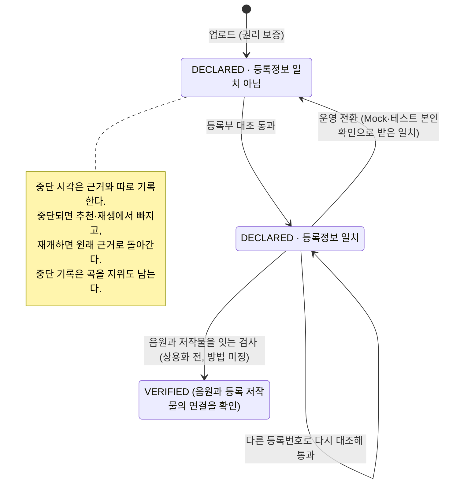

# ADR: 곡 권리 검증 — 등록부 자동 대조와 권리 보증

- 상태: **Proposed** (PR 리뷰에서 확정)
- 결정일: **2026-10-20** (NSU-89 설계 세션 `51255b80`, NSU-48·89 설계 세션)
- 관련: [04 곡 API §1.1·§3](../../api/04_music.md), [02 추천 응답 §2.3·§2.5·§4.2](../../api/02_recommendation_trust_and_new_artist.md), [01 Trust Profile §4.3](../../api/01_trust_profile.md), [00 업로드 검사](./00_music_upload_validation.md), SSOT `RIGHTS-014`~`026`·`AI-030`~`032`·`AUTH-009`·`ADMIN-096`·`STORAGE-102`, NSU-89·104·105

---

## Decision

**권리는 곡마다 확인한다. 모든 곡은 아티스트의 권리 보증으로 "보증됨"(`DECLARED`)이 되고 추천 후보다. 저작권을 등록한 곡은 한국저작권위원회 등록부와 자동으로 대조해 "등록정보 일치"를 따로 기록한다. 대조는 본인확인 이름이 등록부의 저작자 이름과 같다는 것까지만 확인한다. 동명이인을 가리지 못하고, 올린 음원이 그 저작물인지도 모른다. 그래서 권리 근거도 권한도 바꾸지 않는다. PRIVATE 행사 열람·댓글 권한(`VERIFIED_ARTIST`)은 실명 본인확인으로 정한다. 사람이 서류를 심사하지 않는다.**

| 항목 | 결정 | 출처 |
|---|---|---|
| 검증 단위 | 곡. Work와 AI Sample을 "곡" 하나로 합친다 | `51255b80` 2-2·2-4 |
| 권리 근거 | `DECLARED`: 업로드 때 권리 보증(필수). `VERIFIED`: 올린 음원이 등록 저작물임을 확인함. 지금은 `VERIFIED`를 주는 경로가 없고, 오디오 지문 검사처럼 음원과 저작물을 잇는 검사를 넣을 때 정한다 | `51255b80` 2-1, 질문 19, 설계 리뷰 2026-10-21 |
| 등록정보 일치 | 등록부 대조를 통과하면 곡에 따로 기록한다(`rights.isRegistrationMatched`). 권리 근거도 권한도 바꾸지 않는 정보다 | 설계 리뷰 2026-10-21 1·2차 |
| 중단 | 근거와 따로 중단 시각을 둔다. 권리 신고로 중단되고(NSU-104), 재개하면 원래 근거로 돌아간다 | 질문 19 |
| 중단 기록 | 중단은 (아티스트, 파일 SHA-256) 기록으로도 남긴다. 곡을 지우거나 원본을 바꿔도 남고, 정식 재개 절차로만 풀린다. 기록이 남은 파일을 다시 올리면 `409 MUSIC_RIGHTS_SUSPENDED`다 | 설계 리뷰 2026-10-21 |
| 추천 후보 | `DECLARED`·`VERIFIED` 모두. 중단된 곡은 빠진다 | 질문 10 |
| 자동 대조 | 등록번호로 등록정보 OpenAPI를 조회해 번호·저작물 분류·제호·저작자(권리자) 이름을 맞춘다. 통과하면 등록정보 일치다 | 질문 9·16, 설계 리뷰 2026-10-21 |
| 본인확인 | 등록부 대조에는 본인확인 이름이 필요하다(NSU-105). 시연을 위해 Mock·테스트 인증 이름도 쓴다 | 질문 16 |
| 등록 정보 제출 | 곡 업로드와 따로 받는다(`PUT …/copyright-registration`) | 질문 18 |
| 등록번호 중복 | 한 아티스트 안에서만 막는다(한 등록번호는 내 곡 하나에만). 공동 저작자·권리자는 같은 번호로 각자 대조를 통과할 수 있다 | 설계 리뷰 2026-10-21 2차 |
| 등록증 파일 | 같은 S3 버킷의 `private/rights-evidence/`. 경로별 IAM으로 AI 서버·재생 경로가 읽지 못하게 한다. PDF·JPEG·PNG, 5MiB 이하. 열람 API는 없다. 곡을 삭제하면 7일 안에 함께 지운다 | 질문 20 |
| 커버곡 | 업로드 때 "커버곡(원저작자 있음)" 여부만 받는다. 사용승인서 보유 보증은 받지 않는다 | 2026-10-20 |
| 신탁 여부 | 업로드 때 KOMCA·KOSCAP에 신탁한 곡인지 자기 신고로 받아 기록한다 | 2026-10-20 |
| `VERIFIED_ARTIST` | 실명 본인확인(NSU-105)을 마친 `ACTIVE` ARTIST. PRIVATE 행사 열람(`EVT-043`·`044`)과 댓글(`CMT-045`)에 쓴다. 등록정보 일치는 동명이인을 가리지 못해 근거로 쓰지 않는다 | `51255b80` 2-3, 설계 리뷰 2026-10-21 2차(사용자 P안) |
| AI 추천 조건(`AI-031`) | 계정이 `ACTIVE`인 ARTIST, AI 분석 동의, 추천에 쓸 수 있는 곡(보증·검증, 중단 아님) 1개 이상. `VERIFIED_ARTIST`를 조건에서 뺀다 | 질문 23 |
| Trust Profile `COPYRIGHT` | 등록정보가 일치하고 중단되지 않은 곡이 1개 이상일 때만 넣는다. 화면 표시는 "등록부 저작자와 실명 일치"이고, 권한이 아니라 정보다 | 01 §4.3, 설계 리뷰 2026-10-21 1·2차 |
| 취소·삭제 절차 | 신고 → 즉시 중단 → 통보 → 재개, 반복 침해 계정 정지, 수령인 공지. NSU-104로 반드시 구현한다 | 2026-10-20 |
| 들이지 않는 것 | 관리자 서류 심사, JEV, Spring AI 서류 판독, KOMCA 작품확인서·사용승인서 검증 | 2026-10-20 |

**본인확인 출처 안전장치** (질문 16)

1. 본인확인 기록과 등록부 대조 기록에 출처(`MOCK`·`SANDBOX`·`PRODUCTION`)를 남긴다.
2. 운영 환경에서는 Mock·테스트 본인확인 제공자를 켤 수 없게 한다.
3. 운영으로 넘어갈 때 `MOCK`·`SANDBOX` 본인확인은 무효로 한다. 그 이름으로 받은 등록정보 일치를 지우고, 그 본인확인으로 얻은 `VERIFIED_ARTIST`도 풀린다. 아티스트는 운영 본인확인을 다시 받아야 한다.
4. 본인확인을 하지 않은 아티스트는 등록 정보를 낼 수 없다(`403 IDENTITY_VERIFICATION_REQUIRED`). 그런 아티스트의 곡은 등록정보 일치를 받지 못한다.

## Context

**원래 SSOT 정책과 구현 공백**
- SSOT는 Work를 먼저 권리 검증하고(`RIGHTS-014`~`025`), 그 결과로 `VERIFIED_ARTIST`를 정했다. 판정은 "외부 API + 공적 증빙 + 관리자 확인"이다(`RIGHTS-018`).
- 이를 구현할 이슈가 없었고, Spring에는 Work 테이블도 없었다.
- 한국예술인복지재단 예술활동증명도 곡마다 서류를 받고, 분야별 심의위원회가 사람이 심사한다.

**확인한 사실 (2026-10-20)**

| 수단 | 우리 서류에 쓸 수 있나 |
|---|---|
| 한국저작권위원회 저작권등록정보 OpenAPI (data.go.kr 15106731) | 쓸 수 있다. 등록번호로 저작물·저작자·권리자 등을 조회한다. 개발은 자동 승인, 운영은 심의 승인이다 |
| 정부24 진위확인 | 쓸 수 없다. 정부24에서 발급한 민원서류만 대상이다 |
| 상용 전자서류 진위확인 API | 쓸 수 없다. 저작권 서류 지원 언급이 없다 |
| KOMCA | 공개 API가 없다. 작품확인서가 전자서명 PDF인지는 확인하지 못했다(회원 로그인 뒤 발급) |
| JEV (TypeSafe System One, Spring AI 연동 0.1.0) | 쓸 수 없다. 문장·JSON을 받아 예/아니오·선택·척도로 판단하는 모델이다. 이미지나 PDF 서명을 보지 않고, 발급 기관 기록에 접근하지 못한다 |
| Spring AI 2.0 멀티모달 | 서류에서 칸을 읽을 수는 있다. 진위는 판정하지 못한다 |

**샘플의 용도**
- 곡은 원본 전체가 아니라 섭외용 샘플(56~80초)이다.
- 그 행사의 EVENT_PARTNER에게만, 10분짜리 Signed URL로, 재생 기록과 요청 제한을 두고 들려준다(02 §2.5).

**법적 배경** (공개 자료 정리이며 법률 자문이 아니다)
- 약관으로 아티스트에게 책임을 넘겨도 권리자(제3자)에 대한 플랫폼 책임은 없어지지 않는다.
- 사업자의 고의·중과실 책임을 면제하는 약관 조항은 무효다(약관의 규제에 관한 법률 제7조).
- 플랫폼을 실제로 보호하는 것은 저작권법 제102조·제103조의 온라인서비스제공자 면책이다. 반복 침해자 계정 해지 방침, 침해를 알거나 중단 요구를 받으면 즉시 중단, 중단 요구 수령인 지정·공지가 요건이다. 모니터링 의무는 없다(제102조 제3항).
- KOMCA에 신탁한 곡은 저작자가 전송 권리를 협회에 맡긴 곡이다. 그래서 아티스트가 동의해도 플랫폼이 재생할 권리가 생기지 않는다. KOMCA 징수규정 제23조 제5항은 무료 홍보용 스트리밍(30초, 협의하면 60초 이내, 사전 신고)의 사용료 면제를 둔다.

## Rationale

### 서류를 검사하지 않고 장부와 대조한다

위조 서류를 판정하는 API는 우리가 받을 서류에 대해 없다. 모델이 서류를 읽어도 그럴듯하게 만든 직인과 진짜 직인을 구분할 근거가 없다. 등록번호로 공적 장부(등록부)를 조회하면 서류가 진짜인지 따질 필요가 없다. 장부에 적힌 사실과 직접 맞추기 때문이다. 관리자 없이 업로드한 직후에 판정할 수 있는 수단도 이것뿐이다.

### 등록정보 일치는 권리 근거를 바꾸지 않는다

등록부에는 저작물의 번호·분류·제호·저작자가 있고 음원은 없다. 그래서 대조가 확인하는 것은 "본인확인 이름이 등록부의 저작자 이름과 같고, 그 제호로 등록된 번호를 냈다"까지다.

예: 등록 저작자 김OO이 자기 곡 "봄비"의 등록번호를 남의 음원 파일에 붙여 올린다. 번호·분류·제호·이름이 모두 맞아 대조를 통과한다. 대조 통과를 `VERIFIED`로 두면 확인하지 않은 남의 음원이 "검증됨"이 되고, EVENT_PARTNER는 그 표시를 믿는다.

| 관점 | 등록정보 일치를 따로 기록 (채택) | 대조 통과를 `VERIFIED`로 (첫 안) |
|---|---|---|
| 정확성 | 표시가 확인한 사실("등록 저작자 본인")과 같다 | `VERIFIED`가 "이 음원의 권리를 검증함"으로 읽혀 남의 음원에도 붙는다 |
| 보안 | 위 예의 음원은 `DECLARED`라 "검증된 음원"으로 보이지 않는다 | 위 예의 남의 음원이 "검증됨"이 된다 |
| 성능 | 차이 없음(OpenAPI 1회, 같은 대기) | 차이 없음 |
| 메모리 | 차이 없음 | 차이 없음 |
| 확장성 | 음원과 저작물을 잇는 검사가 생기면 그때 `VERIFIED`를 준다. 기존 데이터의 뜻이 바뀌지 않는다 | 그런 검사를 넣으면 `VERIFIED`의 뜻이 바뀌어 기존 곡을 다시 검사하고 내려야 한다 |
| 운영 부담 | 나중에 데이터를 옮길 일이 없다 | 검사 도입 때 데이터 이전과 아티스트 안내가 필요하다 |
| 사용자 경험 | 아티스트 표시가 "등록부 저작자와 실명 일치"로 조금 약하다. EVENT_PARTNER는 표시가 주장하는 만큼만 믿으면 된다 | 아티스트에게 "검증됨"이 바로 붙는다. EVENT_PARTNER는 표시를 실제보다 강하게 읽는다 |
| 구현량 | 응답에 칸 1개, 01 §4.3·SSOT 후보 문구 수정 | 문서 문구만 |

### `VERIFIED_ARTIST`는 실명 본인확인으로 정한다

등록정보 일치를 PRIVATE 행사 열람·댓글 권한의 근거로 쓰면, 동명이인이 남의 등록으로 권한을 얻는다.

예: 이름이 "김민수"인 사람이 등록부를 저작자 이름으로 검색해, 다른 "김민수"가 등록한 곡 "봄비"를 찾는다. 제목을 "봄비"로 한 아무 음원에 그 등록번호를 붙이면 대조를 통과한다. 운영 본인확인을 써도 같다. 대조하는 값이 이름 하나이기 때문이다.

| 관점 | 권한은 본인확인으로, 이름 일치는 정보로 (채택) | 이름+생년월일 대조 | 등록정보 일치로 권한 (지난 안) |
|---|---|---|---|
| 정확성 | 권한의 근거(실명 본인확인)를 남이 흉내 낼 수 없다 | 동명이인 대부분을 가린다. OpenAPI가 생년월일을 주는지 모른다 | 동명이인이 등록 저작자로 표시된다 |
| 보안 | 남의 등록으로 권한을 얻는 길이 없다 | 이름과 생일이 모두 같은 경우만 남는다 | 위 예처럼 권한을 얻는다 |
| 성능 | 차이 없음(본인확인 여부 조회 1회) | 차이 없음 | 차이 없음 |
| 메모리 | 차이 없음 | 차이 없음 | 차이 없음 |
| 확장성 | 등록하지 않은 아티스트에게도 같은 기준이 적용된다 | OpenAPI 필드와 본인확인 데이터 형식에 묶인다 | 사용자가 늘수록 동명이인도 는다 |
| 운영 부담 | 낮다 | 생년월일(개인정보) 보관·파기 관리가 는다 | 잘못 붙은 등록의 신고·분쟁 처리 |
| 사용자 경험 | 본인확인만 하면 PRIVATE 열람·댓글이 열린다. 배지 문구는 약해진다 | 등록 저작자는 강한 표시를 받는다 | 가장 편하지만 표시를 믿을 수 없다 |
| 구현량 | `VERIFIED_ARTIST` 정의와 문서 문구 | 위에 더해 생년월일 대조·보관 | 문서만 |

- `VERIFIED_ARTIST`는 실명 본인확인(NSU-105)을 마친 `ACTIVE` ARTIST다. 본인확인은 국내 본인확인기관을 거쳐 남이 흉내 낼 수 없고, 문제가 생기면 책임을 물을 실명이 남는다.
- 등록정보 일치는 곡의 정보 표시와 Trust Profile `COPYRIGHT`("등록부 저작자와 실명 일치")에만 쓴다.
- 시연에서는 Mock·테스트 본인확인으로 `VERIFIED_ARTIST`가 된다. 운영으로 넘어갈 때 그 본인확인을 무효로 하므로 함께 풀린다(본인확인 출처 안전장치 3).

### 등록하지 않은 곡은 보증으로 받는다

곡마다 등록비가 들어서, 등록한 곡만 받으면 대부분의 인디 아티스트가 후보에서 빠진다. 샘플은 판매·배포가 아니라 특정 EVENT_PARTNER에게만 짧게 들려주는 용도다. 그래서 권리 보증과 "신고받으면 즉시 중단"(NSU-104)이 피해 규모에 맞는 수준이다. 확인하지도 못할 서류를 받아 보관하면 민감 정보 부담만 늘어난다.

### 본인확인 이름과 대조한다

이름을 대조하지 않으면 남의 등록번호와 제목만 맞춰도 등록정보 일치가 된다. 실명 본인확인(국내 본인확인기관, 정보통신망법 제23조의3)은 계약이 필요하다. 사업자등록 없이 계약할 수 있는지는 공개 자료로 확인하지 못했다. 그래서 Mock과 PortOne V2 테스트 연동까지 만들고(NSU-105), 시연에서는 그 이름으로 대조한다. 가짜 이름으로 받은 등록정보 일치가 운영 데이터에 섞이지 않도록 출처를 기록하고 운영 전환 때 지운다.

### 등록 정보를 업로드와 따로 받는다

같은 요청에 넣으면 10MiB 전송과 외부 API 응답 대기가 한 요청에 묶인다. 외부 API가 느리거나 실패하면 두 파일을 통째로 다시 보내야 한다. 따로 받으면 업로드는 외부 API와 무관하게 끝나고, 대조가 실패해도 곡은 `DECLARED`로 남는다. 본인확인을 마친 뒤 이미 올린 곡에 등록 정보를 붙일 수도 있다.

### 권리 상태를 근거와 중단으로 나눈다

한 칸 상태(`DECLARED`·`VERIFIED`·`SUSPENDED`)로 두면, 재개할 때 돌아갈 상태를 따로 기억해야 한다. 이를 빠뜨리면 재개한 곡이 원래 근거를 잃는다. 두 칸으로 나누면 재개할 때 중단 시각만 지우면 된다. 근거(예: 관리자 확인)와 중단 사유도 서로 따로 늘릴 수 있다.

### 중단 기록은 곡을 지워도 남긴다

중단 시각이 곡에만 있으면, 중단된 곡을 지우고 같은 파일을 새 곡으로 올리는 것만으로 중단이 풀린다. 새 곡은 `DECLARED`·중단 아님으로 시작하기 때문이다. 그러면 신고 → 중단 → 재개 절차(NSU-104)가 의미를 잃고, 면책 요건인 "즉시 중단"도 지키지 못한다. 그래서 중단을 (아티스트, 파일 SHA-256) 기록으로도 남기고, 업로드가 이 기록을 확인한다.

| 범위 | 결정 | 이유 |
|---|---|---|
| 같은 아티스트, 같은 파일 | 거절한다 | 우회를 막는다 |
| 다른 아티스트, 같은 파일 | 막지 않는다 | 신고한 진짜 권리자가 자기 파일을 올리는 것까지 막게 된다 |
| 다시 인코딩한 파일 | 막지 못한다 | SHA-256이 바뀐다. 오디오 지문 검사(상용화 전 1순위)로 막는다 |

- 중단된 곡과 같은 파일로 새 곡을 만들지 않고 거절한다. 중단 상태를 이어받은 새 곡을 만들면 3곡 한도와 저장 공간만 차지한다.
- 기록은 NSU-104가 만든다. NSU-89는 기록을 읽는 창구만 두고, NSU-104 전에는 "기록 없음"을 돌려주는 빈 구현을 쓴다. NSU-104 전에는 곡을 중단할 수 없으니 이 값은 사실과 같다.

### 등록증은 같은 버킷의 별도 경로에 둔다

`STORAGE-102`의 예시(`private/rights-evidence/...`)를 따른다. 전용 버킷으로 권한과 암호화 키를 나누는 안을 함께 검토했지만, 사용자는 버킷 하나로 관리하는 쪽을 골랐다. 그 대신 경로별 IAM 정책이 필수다. AI 서버가 음원을 S3에서 직접 읽게 되더라도 이 경로에는 닿지 않아야 한다.

### 커버곡은 표시만 받는다

사용승인서는 KOMCA의 복제 이용허락 절차에서 발급되는 서류로, 그 음반을 만드는 일에 대한 허락이다. 징수규정상 스트리밍(전송)은 서비스 사업자가 따로 허락받는 구조다. 그래서 아티스트가 진짜 사용승인서를 갖고 있어도 플랫폼의 재생 근거가 되지 않는다. 자동으로 대조할 방법도 없다. 재생 근거는 플랫폼의 KOMCA 사전 신고·협의로 마련하고(상용화 전), 분쟁은 NSU-104 절차로 다룬다.

### 신탁 여부를 자기 신고로 받는다

KOMCA 신탁 여부를 자동으로 확인할 공개 API가 없다. 등록부와 신탁은 다른 제도라 등록정보 OpenAPI로도 알 수 없다. 신고값은 상용화 전 KOMCA 사전 신고·협의의 대상 곡을 세는 데 쓴다.

### AI 추천 조건에서 `VERIFIED_ARTIST`를 뺀다

`VERIFIED_ARTIST`(실명 본인확인)를 AI 추천 조건에 그대로 쓰면, 본인확인을 하지 않은 아티스트는 AI 추천을 켤 수 없다. 본인확인은 MVP에서 Mock·테스트 연동뿐이고(NSU-105), 보증만 한 곡도 후보로 받기로 했다(질문 10). 그래서 AI 참여 조건과 PRIVATE 열람·댓글 권한을 나눈다.

### JEV·Spring AI·관리자 심사를 들이지 않는다

JEV는 문장의 그럴듯함을 판단하는 모델이라 진위를 가리지 못한다. 신뢰도가 낮은 건을 사람에게 보내는 것이 강점인데, 보낼 관리자가 없다. Spring AI 서류 판독은 등록번호 입력을 돕는 정도인데, 아티스트가 번호를 직접 입력하면 된다. 관리자 심사는 화면과 업무가 필요하고, 사용자는 관리자 개입 없는 자동화를 원했다.

## Consequences

- NSU-104(신고·중단·재개·반복 침해 정지)를 반드시 구현한다. 보증을 받아들이는 대가이며, 면책 요건이다.
  - 중단은 곡의 중단 시각과 함께 (아티스트, 파일 SHA-256) 기록으로 남긴다. 정식 재개 절차만 이 기록을 푼다.
  - NSU-103의 곡 삭제·원본 교체는 이 기록을 지우지 않는다.
- 등록 정보 제출은 NSU-105(본인확인)가 있어야 동작한다.
- 01 Trust Profile의 `COPYRIGHT`는 곡의 등록정보 일치로 계산하고, 화면에는 "등록부 저작자와 실명 일치"로 표시한다. 권한의 근거가 아니다.
- PRIVATE 행사 열람·댓글(`VERIFIED_ARTIST`)도 NSU-105(본인확인)가 있어야 열린다.
- `51255b80`에서 적어 둔 SSOT v1.17 후보 가운데 아래 항목은 이 ADR로 바뀐다.

| `51255b80`의 v1.17 후보 | 이 ADR |
|---|---|
| 판정 방법: 외부 API + 공적 증빙 + 관리자 확인(`RIGHTS-018`) 그대로 | 권리 보증 + 등록부 자동 대조(등록정보 일치, 권리 근거는 바꾸지 않음). 관리자 확인 없음 |
| KOMCA·KOSCAP 서류를 주 증빙(택1)으로 | 검증 문서로 받지 않는다. 검증 문서는 한국저작권위원회 등록증(등록번호)뿐이다 |
| 커버곡은 사용승인서가 있으면 인정 | "커버곡" 표시만 받고 보증으로 다룬다 |
| 노래만 부른 곡(실연자) 인정 | 그대로. 보증으로 받는다 |

- SSOT v1.17(승인 필요): 위 표, `VERIFIED_ARTIST` 정의(실명 본인확인을 마친 `ACTIVE` ARTIST), `ADMIN-096` 표시 문구("등록부 저작자와 실명 일치"), `AI-030`·`AI-031` 조건 변경, `AI-032` 최대 3곡.
- **알려진 위험**
  - 보증은 증명이 아니다. 남의 곡을 보증하고 올리면 신고를 받기 전까지 추천·재생된다.
  - 동명이인은 이름 대조로 막지 못한다. 그래서 등록정보 일치는 정보로만 쓰고 권한의 근거로 쓰지 않는다.
  - 등록 저작자가 자기 등록번호를 남의 음원에 붙이면 등록정보 일치를 받는다. 그래서 일치는 권리 근거를 바꾸지 않고 "등록부 저작자와 실명 일치"로만 표시한다. 그 음원은 신고로 중단한다.
  - 예명으로 등록한 곡은 `DECLARED`로 남는다.
  - 중단된 곡을 지우고 다시 인코딩한 파일로 올리면 중단 기록(SHA-256)에 걸리지 않는다. 오디오 지문 검사 전까지는 신고로 다시 중단한다.
- **상용화 전 할 일**

| 할 일 | 이유 |
|---|---|
| KOMCA 사전 신고·협의(징수규정 제23조 제5항) 또는 이용허락 | 신탁한 곡의 재생 근거 |
| 전문가 확인: AI 분석(임베딩 만들기)이 복제에 해당하는지 | 신탁한 곡의 분석 근거 |
| 전문가 확인: AI 추천이 면책 요건의 "저작물·수신자를 선택하지 않은 경우"를 깨는지 | 플랫폼 면책 |
| 오디오 지문 검사를 1순위로 도입(ACRCloud 계열. AcoustID는 곡 처음 60초 지문만 있어 중간 조각을 못 찾음) | 발매 음원 조각을 그대로 올리거나 커버곡을 숨기고 올리는 경우를 자동으로 막는다 |
| 운영 본인확인 계약(사업자등록 필요 여부 확인) | Mock·테스트 이름 대조를 실제 실명 대조로 바꾼다 |
| 음원과 등록 저작물을 잇는 검사 방법 정하기(오디오 지문 등) | `VERIFIED`를 줄 근거. 지금은 `VERIFIED`를 주는 경로가 없다 |

## Reused

| 재사용 | 쓰는 곳 |
|---|---|
| 한국저작권위원회 저작권등록정보 OpenAPI | 등록부 대조 |
| 02 §2.5의 Redis 고정 창 카운터와 메모리 대체 | 등록 정보 제출 요청 제한(1시간 10회) |
| NSU-70 `VerificationReader` 창구 | Trust Profile `COPYRIGHT` 계산. 곡 권리 정보를 읽는 구현으로 바꾼다 |
| NSU-105 본인확인 기록 | 등록부 저작자와 대조할 이름, `VERIFIED_ARTIST` 판정 |
| NSU-70의 창구 + 빈 구현 방식(`PerformanceOutcomeReader`·`EmptyPerformanceOutcomeReader`) | 권리 중단 기록 조회. NSU-104 전에는 빈 구현 |

## Rejected Alternatives

| 안 | 버린 이유 |
|---|---|
| 저작권 조건을 아티스트 단위로 두기 | 권리가 취소된 곡이 같은 아티스트의 다른 곡 덕분에 추천·재생된다 |
| 등록곡 대조 + 관리자 심사 경로 유지 | 관리자 화면과 심사 업무가 필요하다. 사용자가 관리자 없는 자동화를 원했다 |
| 보증만 받고 등록부 대조는 하지 않기 | `COPYRIGHT`("등록부 저작자와 실명 일치") 표시의 근거가 없다 |
| 등록정보 일치로 `VERIFIED_ARTIST` 주기 (1차 리뷰 뒤의 안) | 동명이인이 등록부를 이름으로 검색해 남의 등록을 붙이면 PRIVATE 열람·댓글 권한을 얻는다(설계 리뷰 2026-10-21 2차) |
| 이름+생년월일로 대조 | OpenAPI가 저작자 생년월일을 주는지 모르고, 본인확인의 생년월일(개인정보)을 보관해야 한다. OpenAPI 필드를 확인한 뒤 다시 볼 수 있다 |
| 등록번호를 플랫폼 전체에서 한 곡에만 쓰게 하기 | 공동 권리자가 막히고, 먼저 낸 사람이 번호를 차지할 수 있다(설계 리뷰 2026-10-21 2차) |
| 등록부 대조를 통과하면 `VERIFIED` (이 ADR의 첫 안) | 등록 저작자가 자기 등록번호를 남의 음원에 붙여도 통과해, 확인하지 않은 음원이 "검증됨"이 된다(설계 리뷰 2026-10-21) |
| 등록한 곡만 추천 후보로 받기 | 등록비 때문에 대부분의 아티스트가 빠진다 |
| JEV로 서류 진위 판정 | 문장의 그럴듯함만 판단한다 |
| Spring AI로 서류 판독 | 진위를 판정하지 못한다. 등록번호는 직접 입력하면 된다 |
| KOMCA 작품확인서·사용승인서를 검증 문서로 받기 | 자동 대조할 API가 없다 |
| 전자서명 PDF 검증 | KOMCA 확인서가 전자서명 PDF인지 확인하지 못했다. 서명이 진짜여도 제출자가 그 저작자인지는 증명하지 못한다 |
| 업로드 때 입력한 실명과 대조 | 확인하지 않은 실명이라 막는 효과가 없고, 개인정보만 늘어난다 |
| 운영 본인확인 계약을 먼저 하기 | 사업자등록과 비용 문제로 MVP에 넣기 어렵다 |
| 커버곡의 사용승인서 보유 보증 | 검증할 수 없고, 진짜여도 플랫폼의 재생 근거가 아니다 |
| 권리 상태 한 칸 | 재개할 때 원래 근거를 따로 기억해야 한다 |
| 등록증 전용 버킷 | 사용자가 버킷 하나로 관리하는 쪽을 골랐다. 경로별 IAM으로 대신한다 |
| `VERIFIED_ARTIST` 기준을 "보증"으로 낮추기 | 보증만으로 PRIVATE 행사 열람과 댓글이 열린다 |
| `VERIFIED_ARTIST`를 AI 추천 조건에 그대로 두기 | 본인확인을 하지 않은 아티스트가 AI 추천에 참여하지 못한다 |
| 행사의 "자작곡만" 필터 | 같은 설계 세션에서 도입했다가 사용자가 폐지했다 |
