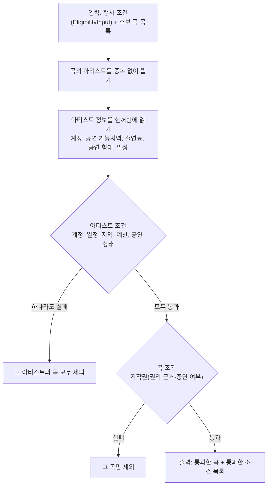

# ADR: Eligibility 판정 규칙과 구조

- 상태: **Proposed** (PR 리뷰에서 확정)
- 결정일: **2026-10-20** (NSU-48 설계 세션)
- 관련: [02 추천 응답 §1·§2.3·§4.2](../../api/02_recommendation_trust_and_new_artist.md), [04 곡 API §1.1](../../api/04_music.md), [music_upload/01 곡 권리 검증](../music_upload/01_music_rights_verification.md), SSOT `AI-MATCH-051`·`ART-027`~`029`·`AI-031`, 서버 협의 009·014, NSU-48. NSU-13은 이 이슈의 중복으로 닫았다

---

## Decision

**Eligibility는 후보 곡을 받아 필수 조건을 PASS/FAIL로 판정하고, 통과한 곡과 그 곡이 통과한 조건 목록을 돌려준다.** 저작권 조건은 곡마다, 나머지 조건은 아티스트마다 한 번 판정한다.

| 값 | 단위 | 통과 기준 | 판정에 쓰는 데이터 | 데이터가 없으면 |
|---|---|---|---|---|
| `ACCOUNT_ACTIVE` | 아티스트 | `role = ARTIST` 그리고 `status = ACTIVE` | `users` (있음) | 실패 |
| `COPYRIGHT_SATISFIED` | 곡 | 권리 근거가 `DECLARED` 또는 `VERIFIED`이고, 중단 시각이 없다 | 후보 곡 (곡 테이블, NSU-89) | 실패 |
| `SCHEDULE_AVAILABLE` | 아티스트 | `AVAILABLE` 일정을 이어 붙인 구간이 행사 시간대 전체를 덮고, 행사 시간대와 겹치는 `HOLD`·`BOOKED`·`UNAVAILABLE` 일정이 없다 | 공연 가능 일정 (NSU-12·34) | 실패 |
| `REGION_REACHABLE` | 아티스트 | 공연 가능지역에 행사의 시·군·구 코드(5자리)나 그 시·도 코드(앞 2자리)가 있다 | 아티스트 프로필 (NSU-12) | 실패 |
| `BUDGET_WITHIN_RANGE` | 아티스트 | 출연료 최소 ≤ 행사 예산 최대 (경계 포함) | 아티스트 프로필 (NSU-12) | 실패 |
| `PERFORMANCE_TYPE_MATCHED` | 아티스트 | 행사가 형태를 지정하지 않으면(`artistType = null`) 평가하지 않는다. 지정하면 그 형태가 아티스트의 공연 형태 목록에 있다 | 아티스트 프로필 (NSU-12) | 행사가 형태를 지정했으면 실패 |

- 활동 정지(`SUSPENDED`)와 탈퇴(`WITHDRAWN`)는 `ACCOUNT_ACTIVE`에서 걸러진다. 활동 정지는 `passedConditions`에 따로 표시하지 않는다(02 §2.3).
- 하나라도 실패하면 그 곡은 후보에서 빠진다(SSOT `AI-MATCH-051`).
- `passedConditions`는 위 표의 순서다. `PERFORMANCE_TYPE_MATCHED`는 평가했을 때만 넣는다.

**시간 규칙 (`SCHEDULE_AVAILABLE`)**

- 시각은 `Asia/Seoul` 벽시계 값(`EligibilityInput`의 `LocalDateTime`)이다.
- 구간은 시작을 포함하고 끝을 포함하지 않는다(`[시작, 끝)`). 그래서 끝이 맞닿은 일정은 겹치지 않는다. 예: 22:00에 시작하는 `BOOKED`는 22:00에 끝나는 행사와 겹치지 않는다.
- 이어지거나 겹치는 `AVAILABLE` 일정은 하나로 합쳐서 본다. 예: 12:00~20:00과 20:00~23:00을 합치면 18:00~22:00을 덮는다.
- `AVAILABLE`과 막힌 일정(`HOLD`·`BOOKED`·`UNAVAILABLE`)이 겹치면 막힌 일정이 이긴다.



**구조**

```java
// 위치: com.nsu.capstone.recommendation.eligibility
public List<EligibleMusic> filter(EligibilityInput event, List<MusicCandidate> candidates)

record MusicCandidate(UUID musicId, long audioRevision, UUID artistId,
                      RightsBasis rightsBasis, boolean isSuspended) {}
record EligibleMusic(UUID musicId, long audioRevision, UUID artistId,
                     List<EligibilityCondition> passedConditions) {}
```

- 후보 곡을 모으는 일은 추천 코드(NSU-63)가 한다. 후보는 `AI_RECOMMENDATION_ENABLED`인 아티스트의 ACTIVE 곡이다(02 §1). Eligibility는 걸러 내기만 한다.
- 아티스트 데이터는 창구(인터페이스)로 읽는다. 지금 데이터가 없는 창구에는 "데이터 없음"을 돌려주는 빈 구현을 둔다. NSU-70의 `PerformanceOutcomeReader`·`EmptyPerformanceOutcomeReader`와 같은 방식이다.

| 창구 | 돌려주는 값 | 지금 구현 |
|---|---|---|
| 계정 | 역할, 상태 | `users`를 읽는다(NSU-70의 `TrustProfileQueryService`처럼 `UserRepository`로 일괄 조회) |
| 아티스트 프로필 | 공연 가능지역 코드 집합(2자리·5자리), 출연료 최소, 공연 형태 집합 | 빈 구현 (NSU-12) |
| 공연 가능 일정 | 행사 시간대와 겹치거나 맞닿는 일정 목록(시작, 끝, 상태) | 빈 구현 (NSU-12·34) |

- 아티스트 수와 관계없이 조회 횟수가 일정하다. 계정·프로필·일정을 한 번씩 일괄 조회한다(NSU-70의 `findByArtistIds`와 같다).
- 다시 보기(NSU-86)는 계정 조건과 저작권 조건만 다시 쓴다(02 §4.2). 두 판정은 따로 부를 수 있게 나눠 둔다.

## Context

- SSOT `AI-MATCH-051`은 필수 조건 7개(계정/인증 상태, 행사 시간대 공연 가능, 활동 정지, 저작권, 지역 이동, 예산, 공연 형태)를 PASS/FAIL로만 쓰라고 정한다. 판정식은 정하지 않았다.
- 02 §2.3은 표시 값 6개와 순서를 정했다. 03 §8.2는 예산 판정식을 NSU-48에서 정하라고 남겼다. 03 §7은 공연 가능지역의 시·도 단위 선택을 NSU-12·48에서 정하라고 남겼다.
- 2026-10-20 기준 main에는 `users`, `oauth_accounts`, `regions`, `events` 테이블뿐이다. 아티스트 프로필(공연 가능지역·출연료·공연 형태), 공연 가능 일정, 곡 테이블이 없다.
- 같은 날 NSU-89 설계(`51255b80`)에서 Work와 AI Sample을 "곡"으로 합치고 권리를 곡마다 검증하기로 했다. 그래서 저작권 조건이 곡 단위가 됐다.
- 용어집은 활성화(기본 가입을 마쳐 `ACTIVE`가 되는 것)를 "인증 완료"로 부르지 않는다.

## Rationale

### 판정 코드만 만들고, 없는 데이터는 실패로 본다

아티스트 프로필·일정 테이블은 마이페이지(NSU-12)가 화면과 함께 설계해야 한다. 이 이슈에서 함께 만들면 범위가 2~3배로 늘고, 저작권 데이터는 여전히 다른 이슈(NSU-89)에 있다. 그래서 판정식과 창구만 만든다.

데이터가 없을 때 통과로 보면, 일정·지역·예산을 확인하지 않은 곡이 "조건을 모두 통과했다"는 추천 이유와 함께 나간다. 실패로 보면 추천 결과가 비지만 잘못된 정보는 나가지 않는다. 곡 테이블도 아직 없으므로, 어느 쪽이든 지금은 추천 결과가 `[]`다.

### 계정 조건의 이름을 `ACCOUNT_ACTIVE`로 바꾼다

이 조건이 보는 것은 기본 가입을 마친 `ACTIVE` 계정이다. 2026-10-04 Auth 정책(`RIGHTS-024`·`026`)에서 계정 활성화와 저작권 등 Trust Verification을 나눴다. 저작권은 별도 조건(`COPYRIGHT_SATISFIED`)이 본다.

`ARTIST_VERIFIED`라는 이름은 "검증된 아티스트"로 읽히고, 화면 문구가 "인증된 아티스트"가 되기 쉽다. 이는 용어집이 피하라고 한 표현이다. 아직 구현 전이고 프론트도 이 값을 쓰지 않아 이름을 바꾸는 비용이 작다.

### 저작권 조건은 곡 단위다

한 아티스트에게 권리가 확인된 곡 A와 권리가 취소된 곡 B가 있으면, 아티스트 단위 판정은 B까지 통과시킨다. 추천 목록은 곡 원본을 바로 재생하므로(02 §2.5), B를 들려주면 남의 곡을 들려주는 셈이다. NSU-89 설계(`51255b80` 2-4)에서 곡 단위로 정했고, 이 ADR은 그 결정을 따른다.

곡의 권리 정보(근거, 중단 여부)는 후보 곡을 모을 때 곡 테이블에서 함께 읽어 `MusicCandidate`로 넘긴다. Eligibility가 곡 테이블을 한 번 더 읽지 않게 하기 위해서다.

### 일정은 가능한 시간을 요구한다

막힌 일정만 보는 방식(일정을 적지 않은 아티스트는 통과)을 함께 검토했다. 그 방식은 신규 아티스트도 후보가 되지만, 일정을 관리하지 않는 아티스트가 실제로는 안 되는 날에 추천된다. 사용자는 추천된 아티스트가 그날 된다고 직접 적은 사람이어야 한다는 쪽을 골랐다. 그 대가로 일정을 미리 적어야 후보가 되고, 초기에는 후보가 줄어든다.

### 지역은 시·군·구와 시·도 전체를 함께 받는다

"서울 전체"를 고르려고 시·군·구 25개를 모두 고르게 하면 화면이 번거롭고, 행정구역이 개편될 때 빠지는 곳이 생긴다. 시·도 단위만 받으면 "강남·서초만"처럼 좁게 고를 수 없어, 실제로 가지 못하는 곳에서도 추천된다. 시·도 코드는 시·군·구 코드의 앞 2자리라서(03 §7) 두 종류를 함께 받아도 판정은 접두사 비교 하나로 끝난다.

### 예산은 출연료 최소와 예산 최대만 비교한다

SSOT Trust 장은 "예산을 넘는 아티스트는 예산 조건 부적합"이라고만 적는다. 범위가 겹쳐야 통과하는 방식은 예산보다 싼 아티스트(예산 50만~100만, 출연료 10만~30만)를 뺀다. 행사의 `budgetMin`을 "특정 수준의 아티스트를 원한다"는 신호로 쓰는 셈인데, 그 판단은 음악 유사도와 Trust Profile의 몫이다. 무보수 행사(예산 0~0)는 출연료 최소가 0인 아티스트만 통과한다.

### 공연 형태는 여러 개를 고른다

혼자도 공연하고 밴드 편성으로도 공연하는 아티스트가 있다. 하나만 고르게 하면 다른 형태의 행사에서 빠진다. 모든 형태를 고르면 필터가 힘을 잃는다는 단점은 섭외 단계에서 드러나며, 행사 쪽에서 막을 방법은 없다.

### 후보를 모으는 일과 거르는 일을 나눈다

Eligibility가 곡 목록과 AI 추천 상태까지 읽으면 맡는 일이 커진다. 나누면 Eligibility는 필수 조건 판정만 담고, 다시 보기(NSU-86)도 저장된 곡에 같은 판정을 쓴다. 화면·API·DB에는 차이가 없는 서버 내부 구조이므로, 나중에 바꿔도 비용이 작다(사용자가 권장안으로 정하도록 위임).

## Consequences

- 아티스트 프로필·일정 기능(NSU-12·34)이 생기기 전에는 모든 곡이 빠지고 추천 결과가 `[]`다.
- NSU-12·34는 다음 값을 저장해야 한다. 이 ADR이 창구의 모양을 먼저 정한다.
  - 공연 가능지역: 지역 목록(03 §7)의 시·군·구 코드(5자리)와 시·도 코드(2자리) 여러 개
  - 출연료 범위: 최소·최대(원). 판정에는 최소만 쓴다
  - 공연 형태: `ArtistType` 여러 개
  - 공연 가능 일정: 시작·끝(`Asia/Seoul` 벽시계)과 상태(`AVAILABLE`·`HOLD`·`BOOKED`·`UNAVAILABLE`, SSOT `ART-029`)
- 02 §2.3의 `ARTIST_VERIFIED`가 `ACCOUNT_ACTIVE`로 바뀐다. 프론트가 아직 쓰지 않아 하위 호환 문제는 없다.
- 행사에 "자작곡만" 같은 새 조건을 넣지 않는다. 03 행사 계약은 바뀌지 않는다.
- SSOT `AI-MATCH-051`에 판정식과 곡 단위 저작권을 적는 v1.17 개정이 필요하다(승인 필요).

## Reused

| 재사용 | 쓰는 곳 |
|---|---|
| `EligibilityInput`, `EventSnapshot` (NSU-58, `event/recommendation`) | 행사 조건 입력. 새로 만들지 않는다 |
| NSU-70의 창구·빈 구현 방식(`PerformanceOutcomeReader`·`EmptyPerformanceOutcomeReader`)과 `findByArtistIds` 일괄 조회 | 아티스트 프로필·일정 창구, 고정 횟수 조회 |
| `regions` 테이블의 시·도 접두사 규칙(03 §7, `province_code = LEFT(code, 2)`) | 지역 판정 |
| `ArtistType` (`event/domain`) | 공연 형태 판정. 아티스트 프로필도 같은 목록을 쓴다(SSOT v1.16) |

## Rejected Alternatives

| 안 | 버린 이유 |
|---|---|
| 아티스트 프로필·일정 테이블까지 이 이슈에서 만들기 | 마이페이지(NSU-12) 설계를 함께 해야 해 범위가 2~3배다. 저작권 데이터는 여전히 다른 이슈에 있다 |
| NSU-12·33을 먼저 설계하고 NSU-48은 나중에 | Spring↔AI 연동(NSU-63)이 그만큼 늦어진다 |
| 계정 조건을 `VERIFIED_ARTIST`(실명 본인확인을 마친 아티스트)로 판정 | 본인확인을 하지 않은 아티스트가 추천에서 빠진다. `AI-031`에서도 `VERIFIED_ARTIST`를 뺐다([music_upload/01](../music_upload/01_music_rights_verification.md)) |
| `ARTIST_VERIFIED` 이름 유지 | 화면 문구가 "인증된 아티스트"가 되기 쉽고, 용어집과 어긋난다 |
| 저작권 조건을 아티스트 단위로 두고, 권리가 취소된 곡은 곡 쪽에서 끄기 | 곡 쪽 규칙이 구현되기 전까지 취소된 곡이 남는다. NSU-89 설계에서 곡 단위로 정했다 |
| 일정: 막힌 시간만 확인 | 일정을 관리하지 않는 아티스트가 안 되는 날에 추천된다 |
| 지역: 시·군·구만 / 시·도만 | 위 Rationale |
| 예산: 두 범위가 겹쳐야 통과 | 예산보다 싼 아티스트가 빠진다 |
| 공연 형태: 하나만 | 편성을 바꿔 공연하는 아티스트가 빠진다 |
| Eligibility가 후보 곡 모으기까지 맡기 | Eligibility가 곡 목록과 AI 추천 상태까지 알아야 한다 |
| 행사의 "자작곡만" 필터 | 같은 설계 세션에서 도입했다가 사용자가 폐지했다. 업로드 때 자작곡·실연곡을 나눠 받을 이유도 함께 없어졌다 |

## 테스트 기준

| 조건 | 경우 |
|---|---|
| 계정 | `ACTIVE` ARTIST 통과. `SUSPENDED`·`WITHDRAWN` 실패. 후보에 EVENT_PARTNER의 ID가 섞이면 실패 |
| 저작권 | `DECLARED`·`VERIFIED` 통과. 중단된 곡은 실패하고, 같은 아티스트의 중단되지 않은 곡은 통과 |
| 일정 (행사 11/15 18:00~22:00) | 일정 없음 실패. `AVAILABLE` 12:00~23:00 통과. `AVAILABLE` 12:00~20:00 실패. `AVAILABLE` 12:00~20:00 + 20:00~23:00 통과(합침). `AVAILABLE` 12:00~23:00 + `BOOKED` 19:00~21:00 실패. `HOLD`가 겹치면 실패. `BOOKED` 22:00~23:00은 맞닿기만 해서 통과 |
| 일정 (자정 넘김, 행사 22:00~다음 날 02:00) | `AVAILABLE` 21:00~다음 날 03:00 통과. `AVAILABLE` 21:00~24:00만 있으면 실패 |
| 지역 (행사 `11680`) | 공연 가능지역 `[11680]` 통과, `[11]` 통과, `[11650]` 실패, `[41]` 실패, `[]` 실패 |
| 예산 (행사 50만~100만) | 출연료 최소 10만 통과, 100만 통과(경계), 100만 1원 실패. 출연료 미입력 실패 |
| 예산 (무보수 0~0) | 출연료 최소 0 통과, 30만 실패 |
| 공연 형태 | 행사 `null`이면 평가하지 않고 `PERFORMANCE_TYPE_MATCHED`가 없다. 행사 `BAND`, 아티스트 `[SOLO, BAND]` 통과, `[SOLO]` 실패, `[]` 실패 |
| 순서 | `passedConditions`가 `ACCOUNT_ACTIVE` → `COPYRIGHT_SATISFIED` → `SCHEDULE_AVAILABLE` → `REGION_REACHABLE` → `BUDGET_WITHIN_RANGE` → `PERFORMANCE_TYPE_MATCHED` 순서다 |
| 묶음 | 아티스트 조건에 실패한 아티스트의 곡은 모두 빠진다. 곡 조건에 실패한 곡만 빠진다 |
| 조회 횟수 | 아티스트 1명과 100명의 조회 횟수가 같다 |
| 빈 구현 | 프로필·일정 창구가 빈 구현이면 모든 곡이 빠지고 결과가 `[]`다 |
