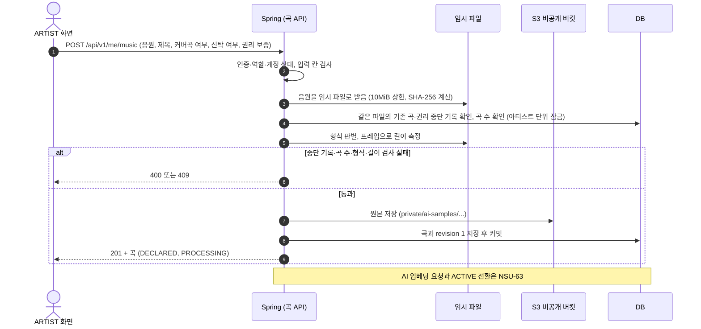
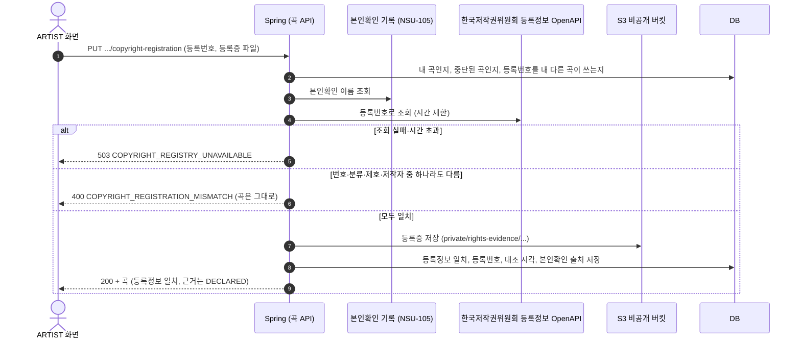

# 곡 API

ARTIST가 추천에 쓸 곡(AI Sample)을 올리고, 저작권을 등록한 곡이면 등록 정보를 내 "등록정보 일치"를 받는 API다.

- 구현 이슈: NSU-89 (새 곡 업로드, 형식·크기·길이 검사, 저작권 등록 정보), NSU-103 (원본 교체·삭제·S3 정리), NSU-104 (권리 신고·재생 중단·재개), NSU-105 (실명 본인확인)
- 요구사항: SSOT v1.16 `AI-030`~`AI-034`, `AI-038`, `RIGHTS-014`~`026`, `STORAGE-101`~`103`, `SEC-118`. 곡 단위 권리 검증은 v1.17 개정 대상이다(§6)
- 결정 기록: [music_upload/00 업로드 검사](../adr/music_upload/00_music_upload_validation.md), [music_upload/01 곡 권리 검증](../adr/music_upload/01_music_rights_verification.md)
- 관련 계약: [02 추천 응답 §2.3·§2.5·§4.2](./02_recommendation_trust_and_new_artist.md), 서버 협의 [001](https://linear.app/nsu-capstone/document/001-audio-revision과-생성-버전-분리-c5c95e36f3e2)·[002](https://linear.app/nsu-capstone/document/002-revision별-벡터-보관과-active-전환-후-정리-e974a4620c8f)·[003](https://linear.app/nsu-capstone/document/003-ai-처리-상태와-backend-활성-상태-분리-3a0c0ca81f50)·[013](https://linear.app/nsu-capstone/document/013-ai-sample-업로드-형식크기와-추천-목록-재생-2a3ba45048cd)·[015](https://linear.app/nsu-capstone/document/015-audiorevision-타입이름증가-규칙과-musicid-타입-75e01dadc3f4)
- 용어: [용어집 (CONTEXT)](https://linear.app/nsu-capstone/document/용어집-context-475370673105)
- 공통 규칙: [00_conventions.md](./00_conventions.md). 에러 형식과 공통 `code`는 [ADR-007](../adr/ADR-007-spring-backend-global-exception-handling.md)을 따른다

> 상태: Proposed. 2026-10-20 NSU-89 설계 세션(`51255b80`)과 NSU-48·89 설계 세션에서 정했다. 업로드 길이를 56~60초로 줄이는 제안은 AI 담당의 확인을 기다린다(§2.2). 확인 전까지는 SSOT `AI-033`의 60~80초를 쓴다.

---

## 0. 범위

| 이 문서가 정한다 | 이 문서가 정하지 않는다 |
|---|---|
| 곡 업로드(§2)와 형식·크기·길이 검사(§2.2) | 곡 목록·상세 조회(NSU-12 마이페이지) |
| 저작권 등록 정보 제출(§3) | 원본 교체·삭제(NSU-103) |
| 곡 표현과 권리 상태(§1.1) | 권리 신고·재생 중단·재개 절차(NSU-104) |
| 응답 상태와 오류(§4) | 실명 본인확인 API(NSU-105) |
| | AI 임베딩 요청, ACTIVE 전환, AI에 보내는 시점(NSU-63) |

## 1. 엔드포인트

| 동작 | 메서드·경로 | 호출 주체 | 성공 |
|---|---|---|---|
| 곡 업로드 | `POST /api/v1/me/music` | ARTIST | `201` + 곡(§1.1) |
| 저작권 등록 정보 제출 | `PUT /api/v1/me/music/{musicId}/copyright-registration` | 그 곡을 올린 ARTIST | `200` + 곡(§1.1) |

- 모든 요청에 `Authorization: Bearer {accessToken}`이 필요하다(00 §7). 본문은 `multipart/form-data`다.
- `music`은 02 §2.5의 재생 주소 경로(`…/music/{musicId}/audio-url`)와 같은 이름이다. 셀 수 없는 명사라 복수형을 만들지 않는다(00 §2 예외).
- `musicId`는 서버가 만드는 UUIDv7이다(서버 협의 015). 소문자 하이픈 표기이며, 형식이 아니면 `400 INVALID_MUSIC_ID`다.
- 저작권 등록 정보는 곡의 1:1 하위 자원이라 `PUT`으로 둔다(00 §2). 같은 요청을 다시 보내도 결과가 같다.
- 조회 API가 없어서 업로드 응답에 `Location`을 넣지 않는다. 조회 API가 생기면 넣는다. 응답 헤더 추가는 하위 호환이다.

### 1.1 곡 (응답 본문)

```json
{
  "musicId": "0192f3c8-5d6e-7f80-9a1b-2c3d4e5f6a7b",
  "title": "봄비",
  "isCover": false,
  "isCollectivelyManaged": false,
  "rights": {
    "basis": "DECLARED",
    "isRegistrationMatched": false,
    "isSuspended": false
  },
  "audioStatus": "PROCESSING",
  "createdAt": "2026-10-20T21:00:00+09:00"
}
```

| 필드 | 타입 | 설명 |
|---|---|---|
| `musicId` | UUID 문자열 | 곡 식별자. AI의 `music_id`와 같은 값이다(서버 협의 015) |
| `title` | 문자열 | 곡 제목 |
| `isCover` | 불리언 | 남이 먼저 발표한 곡을 다시 부른 곡인지. 올릴 때 아티스트가 고른다 |
| `isCollectivelyManaged` | 불리언 | 이 곡의 저작권을 KOMCA·KOSCAP 같은 신탁관리단체에 맡겼는지. 올릴 때 아티스트가 신고한다 |
| `rights.basis` | enum | 권리의 근거. `DECLARED`(아티스트가 권리를 보증함), `VERIFIED`(올린 음원이 등록 저작물임을 확인함). 지금은 `VERIFIED`를 주는 경로가 없다. 오디오 지문 검사처럼 음원과 등록 저작물을 잇는 검사를 넣을 때 정한다 |
| `rights.isRegistrationMatched` | 불리언 | 저작권 등록부와 대조를 통과했는지(§3). 본인확인 이름이 등록부의 저작자 이름과 같고, 그 제호로 등록된 번호를 냈다는 뜻이다. 이름이 같은 다른 사람일 수 있고, 올린 음원이 그 저작물인지도 모른다. 그래서 `basis`도 권한(`VERIFIED_ARTIST`)도 바꾸지 않는 정보다 |
| `rights.isSuspended` | 불리언 | 권리 신고로 재생이 중단됐는지(NSU-104) |
| `audioStatus` | enum | 지금 쓰는 음원의 처리 상태. `PROCESSING`(AI 처리 전·중), `ACTIVE`(추천에 쓸 수 있음), `FAILED`(AI 처리 실패) |
| `createdAt` | 시각 문자열 (00 §4) | 올린 시각 |

- 새 곡은 `rights.basis = DECLARED`, `rights.isRegistrationMatched = false`, `rights.isSuspended = false`, `audioStatus = PROCESSING`으로 시작한다.
- 곡이 추천 후보가 되려면 넷을 모두 만족해야 한다. 이 문서는 앞의 셋을 정하고, 넷째는 SSOT `AI-031`을 따른다.
  1. `rights.basis`가 `DECLARED` 또는 `VERIFIED`다.
  2. `rights.isSuspended = false`다.
  3. `audioStatus = ACTIVE`다.
  4. 곡 아티스트가 `AI_RECOMMENDATION_ENABLED`다. 그 조건은 계정이 `ACTIVE`인 ARTIST, AI 분석 동의, 1·2를 만족하는 곡 1개 이상이다. 등록정보가 일치한 곡이 없어도 된다(2026-10-20 결정, SSOT v1.17 개정 대상).
- 1·2는 Eligibility의 저작권 조건(`COPYRIGHT_SATISFIED`)이다(02 §2.3). 3·4는 후보 곡을 모을 때 거른다(02 §1).
- `audioRevision`은 서버 사이에서만 쓰고 이 응답에 내보내지 않는다(02 §2.1과 같다).
- enum 값은 v1 안에서 추가될 수 있다(00 §3).

## 2. 곡 업로드



### 2.1 요청

```http
POST /api/v1/me/music
Authorization: Bearer {accessToken}
Content-Type: multipart/form-data; boundary=...
```

| 파트 | 타입 | 필수 | 규칙 |
|---|---|---|---|
| `file` | 파일 | O | MP3, 또는 AAC를 담은 M4A(AAC-LC 코어. HE-AAC·HE-AACv2 포함). 10MiB(10,485,760바이트) 이하. 길이는 §2.2 |
| `title` | 문자열 | O | 앞뒤 공백을 지운 뒤 1~100자 |
| `isCover` | 불리언 | O | `true` 또는 `false` |
| `isCollectivelyManaged` | 불리언 | O | `true` 또는 `false` |
| `isRightsWarranted` | 불리언 | O | 권리 보증. `true`만 받는다 |

- 불리언 파트는 문자열 `true`·`false`로 보낸다. 다른 값과 빠진 파트는 `400 VALIDATION_ERROR`다.
- 불리언에 기본값을 두지 않는다. 화면이 커버곡 여부와 신탁 여부를 아티스트에게 꼭 묻게 하기 위해서다.
- 권리 보증은 "이 파일을 플랫폼이 보관·분석하고 EVENT_PARTNER에게 재생할 권리가 있으며, 문제가 생기면 책임진다"는 아티스트의 약속이다(`51255b80` 2-1). 문구는 약관 버전으로 관리한다. 서버는 보증 시각과 그때의 약관 버전을 기록한다.
- 파일 이름과 `Content-Type`은 판정에 쓰지 않는다. 형식은 파일 내용으로 판별한다(§2.2).

### 2.2 검사

| 순서 | 검사 | 실패하면 |
|---|---|---|
| 1 | 로그인 | `401 AUTHENTICATION_REQUIRED` |
| 2 | 역할이 ARTIST이고 계정이 `ACTIVE` | `403 ACCESS_DENIED` |
| 3 | 파트 검증(§2.1) | `400 VALIDATION_ERROR` |
| 4 | 같은 파일(SHA-256)로 이미 올린 곡이 있음(§2.3) | 같은 입력이면 `201` + 그 곡, 다른 입력이면 `409 MUSIC_ALREADY_UPLOADED` |
| 5 | 같은 파일(SHA-256)에 권리 중단 기록이 남아 있음(§2.3) | `409 MUSIC_RIGHTS_SUSPENDED` |
| 6 | 삭제하지 않은 곡이 이미 3개 | `409 MUSIC_LIMIT_EXCEEDED` |
| 7 | 형식: MP3, 또는 AAC를 담은 M4A | `400 UNSUPPORTED_AUDIO_FORMAT` |
| 8 | 길이 | `400 AUDIO_DURATION_OUT_OF_RANGE` |

- **크기**: 10MiB를 넘으면 서버가 파일을 다 받기 전에 끊는다. 응답은 `413`이고 본문은 Spring 표준 `ProblemDetail`이다(ADR-007 §4.4). 화면은 상태 코드로 분기한다. 이 검사는 위 순서와 관계없이 먼저 나올 수 있다.
- **형식**: 파일 앞부분의 바이트로 MP3와 MP4 계열을 가린다. M4A는 오디오 트랙의 코덱이 AAC(`mp4a`)인지 보고, `esds`의 AudioSpecificConfig로 AAC 코어가 AAC-LC(객체 유형 2)인지 본다. HE-AAC(5)·HE-AACv2(29)는 그 안의 코어 객체 유형이 2여야 한다. 다음 파일은 형식 오류로 거절한다.
  - 조각난 MP4(`moof`)
  - 오디오 트랙이 2개 이상인 M4A
  - AAC-LC 코어가 아닌 AAC(AAC-LD·ELD처럼 프레임이 480·512샘플인 형식 등)
  - 지원하지 않는 재생 구간 표(edit list, `edts`·`elst`)가 있는 M4A. 구간 반복, 빈 구간(`media_time = -1`), 속도 변경(`media_rate ≠ 1`), 항목 2개 이상이 그렇다
  - 중간에 샘플레이트가 바뀌는 MP3
- **길이**: 파일 머리말에 적힌 길이를 믿지 않고, 실제 오디오 프레임으로 잰다([music_upload/00](../adr/music_upload/00_music_upload_validation.md)).
  - MP3: 모든 프레임의 길이를 더한다.
  - M4A: AAC 프레임 수 × 프레임 길이 ÷ 코어 샘플레이트로 잰다. 프레임 길이(1024샘플, `frameLengthFlag`가 1이면 960샘플)와 코어 샘플레이트는 AudioSpecificConfig에서 읽는다. `mp4a` 상자의 샘플레이트 칸은 쓰지 않는다.
  - M4A의 일관성 검사: 시간 표(`stts` 합 ÷ `mdhd` 시간 단위)로 잰 길이가 프레임으로 잰 길이와 허용 오차(설정값, 기본 1초) 넘게 다르면 형식 오류다. 재생 구간 표가 있으면 항목 1개, 일반 재생만 받고, 그 구간 길이(`segment_duration` ÷ `mvhd` 시간 단위)도 프레임으로 잰 길이와 허용 오차 안이어야 한다. 인코더가 앞쪽 무음 샘플(priming)을 잘라 내려고 넣는 항목이 이 경우다. 플레이어는 재생 구간 표대로 재생해서, 구간을 반복하거나 잘라 내면 프레임 길이와 실제 재생 길이가 달라지기 때문이다.
  - 허용 범위는 설정값이다. 지금은 SSOT `AI-033`의 **60~80초(경계 포함)**다. AI 담당이 동의하면 **56~60초**로 바꾼다(2026-10-20 Slack 제안). 이 문서의 다른 규칙은 바뀌지 않는다.
  - 경계 근처의 허용 오차는 AI 담당의 답(같은 Slack 제안의 질문 2)을 받아 정한다.
- 검사 3까지는 파일 내용을 보지 않는다. 검사 4부터 받은 임시 파일을 읽는다. SHA-256은 임시 파일에 쓰면서 함께 계산한다.

### 2.3 같은 파일로 다시 올림

**같은 아티스트가 같은 파일을 다시 올리면 새 곡을 만들지 않는다.** 응답을 받지 못해 다시 보낸 업로드가 곡을 하나 더 만들어 3곡 한도를 차지하지 않게 하기 위해서다. 그래서 이 API는 `Idempotency-Key` 헤더를 받지 않는다.

| 같은 파일(SHA-256)로 이미 올린 곡 | 응답 |
|---|---|
| 없음 | 새 곡을 만든다 |
| 있고, `title`·`isCover`·`isCollectivelyManaged`도 같음 | `201` + 그 곡(지금 상태). 새 곡을 만들지 않는다 |
| 있고, 위 값 중 하나라도 다름 | `409 MUSIC_ALREADY_UPLOADED`. 곡은 바뀌지 않는다 |

- 비교 대상은 그 아티스트의 삭제하지 않은 곡이다. 삭제한 곡과 같은 파일은 새 곡으로 올릴 수 있다. 단, 그 파일에 권리 중단 기록이 남아 있으면 올릴 수 없다(아래).
- 다른 아티스트의 곡과는 비교하지 않는다.
- 제목은 앞뒤 공백을 지운 값으로 비교한다.
- 같은 파일을 동시에 두 번 올려도 곡은 하나다. DB가 (아티스트, 파일 SHA-256)의 중복을 막는다. 늦게 온 요청은 먼저 온 요청이 커밋할 때까지 기다린 뒤 위 표대로 응답하고, 이미 올린 자기 S3 원본을 지운다. 지우지 못한 파일은 NSU-103의 정리 작업이 지운다.
- 곡 수 검사(검사 6)는 아티스트 단위 잠금 안에서 센다. 동시에 올려도 4곡이 되지 않는다.
- 잠금과 중복 확인의 기다림에는 상한(설정값, 기본 3초)이 있다. 넘으면 곡을 저장하지 않고 `503 MUSIC_UPLOAD_UNAVAILABLE`이다. 먼저 온 요청이 멈춰도 기다리는 요청들이 DB 연결을 붙잡고 있지 않게 하기 위해서다(03 §5.3.1과 같은 방식). `Retry-After`는 붙이지 않는다.

**권리 중단 기록이 남은 파일은 다시 올릴 수 없다.** 중단된 곡을 지우고 같은 파일을 새 곡으로 올리면, 새 곡은 `DECLARED`·중단 아님으로 시작한다. 그러면 정식 재개 절차(NSU-104) 없이 다시 추천·재생된다. 이를 막는다.

- 중단 기록은 (아티스트, 파일 SHA-256)으로 남는다. 곡을 삭제하거나 원본을 교체해도 지우지 않고(NSU-103), 정식 재개 절차로만 풀린다(NSU-104).
- 업로드는 이 기록을 확인한다(검사 5). 기록이 남아 있으면 `409 MUSIC_RIGHTS_SUSPENDED`이고 곡을 만들지 않는다.
- 기록은 NSU-104가 만든다. NSU-89는 기록을 읽는 창구만 두고, NSU-104 전에는 "기록 없음"을 돌려주는 빈 구현을 쓴다. NSU-104 전에는 곡을 중단할 수 없으니 이 값은 사실과 같다(NSU-70의 빈 구현과 같은 방식).
- 삭제하지 않은 중단된 곡과 같은 파일은 검사 4가 먼저 처리한다. 같은 입력이면 그 곡(`rights.isSuspended = true`)을 돌려준다.
- 다른 아티스트가 같은 파일을 올리는 경우는 이 기록으로 막지 않는다. 신고한 진짜 권리자가 자기 파일을 올리는 것까지 막게 되기 때문이다.
- 다시 인코딩해 SHA-256이 바뀐 파일은 이 기록으로 막지 못한다. 상용화 전 1순위인 오디오 지문 검사로 막는다([music_upload/01](../adr/music_upload/01_music_rights_verification.md)).

**화면이 할 일**
- 응답을 받기 전에는 다시 보내지 않는다. [올리기] 버튼을 막는다.
- 응답을 받지 못했거나 `5xx`(`503 MUSIC_UPLOAD_UNAVAILABLE` 포함)를 받으면 같은 파일과 같은 입력으로 다시 보낸다. 간격을 늘려 가며(1초, 2초, 4초) 3번까지만 보낸다.
- `409 MUSIC_ALREADY_UPLOADED`는 "이미 올린 곡이에요"라고 안내한다.
- `409 MUSIC_RIGHTS_SUSPENDED`는 "권리 신고로 중단된 파일이라 올릴 수 없어요"라고 안내하고 다시 보내지 않는다.

### 2.4 저장

- 원본을 S3 비공개 버킷의 `private/ai-samples/` 아래에 서버가 만든 키로 저장한다(`STORAGE-103`). 아티스트의 파일 이름은 키에 쓰지 않는다.
- 저장 순서는 "S3 저장 → DB 커밋"이다(`51255b80` 질문 8). S3 저장은 업로드 트랜잭션 안에서 한다. 이 트랜잭션은 아티스트 잠금을 잡기 전에 시작해 커밋이나 롤백으로 끝난다.
- **업로드 트랜잭션의 수명은 DB가 강제한다.** 업로드 트랜잭션에 PostgreSQL `transaction_timeout`(설정값, 기본 2분)을 건다. 시간을 넘기면 DB가 세션을 끊어 그 트랜잭션은 커밋될 수 없다. Spring `@Transactional(timeout)`은 SQL을 실행하기 전에만 시간을 확인해 커밋 시각을 보장하지 못하므로, 그것만으로 두지 않는다.
- **S3 원본은 DB에 저장되지 않은 것이 확실할 때만 지운다.** 커밋은 됐는데 응답만 잃었을 때 원본을 지우면, 커밋된 곡이 없는 파일을 가리킨다. 같은 파일로 다시 올려도 §2.3에 따라 그 곡을 돌려줄 뿐이라 복구되지 않는다.

| 실패 | 커밋 | S3 원본 | 응답 |
|---|---|---|---|
| 커밋을 요청하기 전에 난 오류(제약 위반, 잠금 대기 상한, SQL 오류), DB가 커밋을 거절했다고 답함 | 안 됨(확실) | 바로 지운다 | 그 오류의 응답(§2.3·§4). 그 밖은 `500` |
| 커밋을 요청한 뒤 연결이 끊기거나 시간이 초과됨 | 모름 | 지우지 않는다 | `500` |

- 결과를 모르는 원본과 지우지 못한 원본은 NSU-103의 정리 작업이 지운다. 정리 작업은 어떤 revision도 가리키지 않고, S3에 저장된 지 정리 유예(설정값, 기본 1시간)가 지난 키만 지운다.
- 정리 유예는 `transaction_timeout`보다 충분히 길어야 한다. 그렇지 않으면 설정 오류로 서버 시작을 막는다(NSU-103). 원본은 트랜잭션이 시작된 뒤에 저장되므로, 유예가 지난 원본을 만든 트랜잭션은 이미 끝났다. 커밋됐으면 revision이 보이고, 커밋되지 않았으면 다시는 커밋될 수 없다. 그래서 정리 작업이 아직 커밋되지 않은 원본을 지우는 일이 없다.
- 화면은 `500`을 받으면 §2.3대로 같은 파일로 다시 보낸다. 커밋이 됐다면 그 곡(`201`)을 받고, 원본도 남아 있다. 커밋이 안 됐다면 새 곡이 생기고, 앞의 원본은 정리 작업이 지운다.
- 곡, revision 1(`PROCESSING`), 파일 SHA-256, 측정한 길이, 권리 보증 시각과 약관 버전을 저장한다.
- 응답은 `201 Created`이고 본문은 곡(§1.1)이다.

## 3. 저작권 등록 정보 제출

**한국저작권위원회 등록부와 대조해 통과하면 곡에 "등록정보 일치"(`rights.isRegistrationMatched = true`)를 기록한다. 권리 근거는 `DECLARED` 그대로다.** 등록부에는 음원이 없어서, 올린 파일이 그 등록 저작물인지는 이 대조로 알 수 없기 때문이다. 대조는 서버가 등록정보 OpenAPI로 한다. 사람이 서류를 심사하지 않는다([music_upload/01](../adr/music_upload/01_music_rights_verification.md)).



### 3.1 요청

```http
PUT /api/v1/me/music/{musicId}/copyright-registration
Authorization: Bearer {accessToken}
Content-Type: multipart/form-data; boundary=...
```

| 파트 | 타입 | 필수 | 규칙 |
|---|---|---|---|
| `registrationNumber` | 문자열 | O | 한국저작권위원회 저작권 등록번호. 앞뒤 공백을 지운 뒤 1~30자. 정확한 형식은 OpenAPI 활용 신청 뒤 확정한다 |
| `certificate` | 파일 | O | 등록증. PDF·JPEG·PNG, 5MiB(5,242,880바이트) 이하. 형식은 파일 내용으로 판별한다 |

### 3.2 판정

| 순서 | 검사 | 실패하면 |
|---|---|---|
| 1 | 로그인 | `401 AUTHENTICATION_REQUIRED` |
| 2 | 역할이 ARTIST이고 계정이 `ACTIVE` | `403 ACCESS_DENIED` |
| 3 | `musicId` 형식 | `400 INVALID_MUSIC_ID` |
| 4 | 호출자가 올린, 삭제하지 않은 곡 | `404 MUSIC_NOT_FOUND` |
| 5 | 파트 검증(§3.1) | `400 VALIDATION_ERROR` |
| 6 | 실명 본인확인을 마침(NSU-105) | `403 IDENTITY_VERIFICATION_REQUIRED` |
| 7 | 곡이 중단되지 않음 | `409 MUSIC_RIGHTS_SUSPENDED` |
| 8 | 등록증이 PDF·JPEG·PNG이고 5MiB 이하 | `400 UNSUPPORTED_CERTIFICATE_FORMAT`, `413 CERTIFICATE_TOO_LARGE` |
| 9 | 그 등록번호를 내 다른 곡이 쓰지 않음 | `409 COPYRIGHT_REGISTRATION_ALREADY_USED` |
| 10 | 요청 제한(사용자당 1시간 10회, 설정값) | `429 TOO_MANY_REQUESTS`, `Retry-After` |
| 11 | 등록정보 OpenAPI 조회 | `503 COPYRIGHT_REGISTRY_UNAVAILABLE` |
| 12 | 등록부와 대조 | `400 COPYRIGHT_REGISTRATION_MISMATCH` |

**대조 기준 (검사 12)** — 모두 맞아야 통과한다.

| 항목 | 기준 |
|---|---|
| 등록번호 | 등록부에 있다 |
| 저작물 분류 | 음악이다 |
| 제호 | 곡 `title`과 같다. 앞뒤 공백을 지우고, 이어진 공백은 하나로 보고, 영문 대소문자는 구분하지 않는다 |
| 저작자·권리자 | 그중 한 명의 이름이 아티스트의 본인확인 이름과 같다. 공백은 무시한다 |

- **대조가 확인하는 범위**: "본인확인 이름이 등록부의 저작자 이름과 같고, 그 제호로 등록된 번호를 냈다"까지다. 이름이 같은 다른 사람이 등록부를 이름으로 검색해 남의 등록번호를 내도 통과하고, 등록 저작자가 자기 번호를 남의 음원에 붙여도 통과한다. 그래서 통과해도 `rights.basis`와 `VERIFIED_ARTIST`를 바꾸지 않는다. Trust Profile의 `COPYRIGHT`는 "등록부 저작자와 실명 일치"라는 정보로만 쓴다(01 §4.3). 음원과 등록 저작물을 잇는 확인 방법은 상용화 전에 정한다(오디오 지문 검사 등).
- 본인확인 이름에는 Mock·테스트 인증 이름도 쓴다(시연용, 2026-10-20 결정). 대조에 쓴 본인확인의 출처(`MOCK`·`SANDBOX`·`PRODUCTION`)를 기록한다. 운영으로 넘어갈 때 `MOCK`·`SANDBOX`로 받은 등록정보 일치는 지운다(NSU-105).
- 예명으로 등록한 곡은 본인확인 이름과 달라 통과하지 못한다. 그 곡은 등록정보 일치를 받지 못한다.
- **공동 저작자·권리자**: 같은 등록번호를 여러 아티스트가 각자 낼 수 있다. 제출자마다 따로 대조하고, 등록부의 저작자·권리자 중에 자기 본인확인 이름이 있어야 통과한다. 등록번호를 플랫폼 전체에서 한 곡에만 쓰게 하면 공동 권리자가 막히고, 먼저 낸 사람이 번호를 차지할 수 있기 때문이다. 한 아티스트는 한 등록번호를 곡 하나에만 쓴다(검사 9).
- 커버곡은 등록부의 저작자가 원곡 저작자라 통과하지 못한다. 권리 보증(`DECLARED`)으로 추천 후보가 된다.
- **OpenAPI 응답은 신뢰하지 않는 입력으로 다룬다.** 필드가 빠졌거나 형식이 다르면 대조하지 않고 `503`으로 응답하며 서버 로그를 남긴다. `503`의 `message`에 외부 응답 원문을 넣지 않는다(02 §5와 같다).
- 요청 제한은 외부 API를 부르기 직전에 센다(검사 10). 형식이 틀린 요청은 세지 않는다. 카운터는 02 §2.5와 같은 방식이다(Redis 1분 고정 창 대신 1시간 고정 창, Redis에 접속할 수 없으면 서버 메모리 카운터).

**결과**

- 통과하면 등록증을 S3 비공개 버킷의 `private/rights-evidence/` 아래에 저장하고(`STORAGE-102`), `rights.isRegistrationMatched`를 `true`로 바꾼다. `rights.basis`는 바꾸지 않는다. 등록번호, 대조 시각, 본인확인 출처를 함께 저장한다. 응답은 `200`과 곡(§1.1)이다.
- 실패하면 곡은 바뀌지 않는다. 등록증도 저장하지 않는다.
- 이미 등록정보가 일치한 곡에 다른 등록번호를 내면 새로 대조한다. 통과하면 새 등록 정보로 바꾸고 이전 등록증을 지운다. 실패하면 이전 등록 정보가 그대로 남는다.
- 등록증 파일은 열람 API를 두지 않는다. 권리 분쟁(NSU-104)에 대비해 보관만 한다. 곡을 삭제하면 원본과 같은 주기(7일 이내, `AI-038`)로 지운다(NSU-103).
- AI 서버와 재생 주소 발급 경로는 `private/rights-evidence/`를 읽지 못하게 경로별 IAM 정책을 둔다.

## 4. 응답 상태와 오류

오류 본문은 ADR-007의 `{code, message}`다. 표준 `413`(10MiB 초과)만 Spring 표준 `ProblemDetail`이다(ADR-007 §4.4).

| 상황 | HTTP | `code` |
|---|---|---|
| 토큰 없음·만료·서명 오류 | 401 | `AUTHENTICATION_REQUIRED` |
| EVENT_PARTNER가 호출함. 계정이 `ACTIVE`가 아님 | 403 | `ACCESS_DENIED` |
| `musicId`가 UUID 형식이 아님 | 400 | `INVALID_MUSIC_ID` |
| 파트가 빠짐, 불리언이 아닌 값, 제목 길이, `isRightsWarranted = false`, 등록번호 길이 | 400 | `VALIDATION_ERROR` |
| MP3·AAC M4A가 아님. 조각난 MP4, 오디오 트랙 2개 이상, AAC-LC 코어가 아닌 AAC, 지원하지 않는 재생 구간 표(edit list), 샘플레이트가 바뀌는 MP3, 프레임으로 잰 길이와 시간 표·재생 구간이 허용 오차 넘게 다름 | 400 | `UNSUPPORTED_AUDIO_FORMAT` |
| 길이가 허용 범위 밖 | 400 | `AUDIO_DURATION_OUT_OF_RANGE` |
| 등록증이 PDF·JPEG·PNG가 아님 | 400 | `UNSUPPORTED_CERTIFICATE_FORMAT` |
| 등록부와 대조 실패(§3.2) | 400 | `COPYRIGHT_REGISTRATION_MISMATCH` |
| 실명 본인확인을 하지 않음 | 403 | `IDENTITY_VERIFICATION_REQUIRED` |
| 곡이 없음, 삭제됨, 다른 아티스트의 곡 | 404 | `MUSIC_NOT_FOUND` |
| 같은 파일로 올린 곡이 있는데 다른 입력을 보냄(§2.3) | 409 | `MUSIC_ALREADY_UPLOADED` |
| 삭제하지 않은 곡이 이미 3개 | 409 | `MUSIC_LIMIT_EXCEEDED` |
| 권리 신고로 중단된 곡에 등록 정보를 냄. 권리 중단 기록이 남은 파일을 올림(§2.3) | 409 | `MUSIC_RIGHTS_SUSPENDED` |
| 그 등록번호를 내 다른 곡이 쓰고 있음 | 409 | `COPYRIGHT_REGISTRATION_ALREADY_USED` |
| 음원이 10MiB를 넘음 | 413 | 없음. Spring 표준 `ProblemDetail` |
| 등록증이 5MiB를 넘음 | 413 | `CERTIFICATE_TOO_LARGE` |
| 등록 정보 제출 요청 제한을 넘음 | 429 | `TOO_MANY_REQUESTS`, `Retry-After` 헤더 |
| 서버 오류 | 500 | `INTERNAL_SERVER_ERROR` |
| 등록정보 OpenAPI 조회 실패·시간 초과·응답 형식 오류 | 503 | `COPYRIGHT_REGISTRY_UNAVAILABLE` |
| 업로드의 잠금·중복 확인 대기가 상한을 넘음(§2.3). `Retry-After` 없음 | 503 | `MUSIC_UPLOAD_UNAVAILABLE` |

- 다른 아티스트의 곡은 `403`이 아니라 `404`다. 곡 식별자로 다른 아티스트의 곡이 있는지 알아낼 수 없게 하기 위해서다(00 §8).
- 본인확인을 하지 않은 아티스트는 `403 IDENTITY_VERIFICATION_REQUIRED`다. 요청 본문을 고쳐서는 풀리지 않는 선행 조건이라 `400`이 아니다.
- `COPYRIGHT_REGISTRATION_MISMATCH`는 네 기준 중 무엇이 틀렸는지 `code`로 나누지 않는다. `message`에 "제목이 등록부와 달라요"처럼 적을 수 있지만, 클라이언트는 `message`를 파싱하지 않는다(00 §8).

## 5. 테스트 기준

| 대상 | 경우 |
|---|---|
| 역할·상태 | EVENT_PARTNER의 업로드·등록 정보 제출은 `403 ACCESS_DENIED`. `SUSPENDED` 아티스트도 `403` |
| 파트 | 각 필수 파트를 뺀 요청, 불리언에 `"yes"`, 제목 0자·101자, `isRightsWarranted = false`는 `VALIDATION_ERROR`이며 `ProblemDetail`이 아니다 |
| 크기 | 10MiB(10,485,760바이트)는 통과, 1바이트 넘으면 `413`. 등록증 5MiB는 통과, 1바이트 넘으면 `413 CERTIFICATE_TOO_LARGE` |
| 형식 | 확장자를 `.mp3`로 바꾼 WAV·텍스트 파일은 `UNSUPPORTED_AUDIO_FORMAT`. ALAC를 담은 M4A, 조각난 MP4, 오디오 트랙 2개인 M4A, AAC-LD M4A도 같다 |
| 길이 | 허용 범위의 하한·상한과 같은 길이는 통과, 범위 밖은 `AUDIO_DURATION_OUT_OF_RANGE`. CBR·VBR MP3와 ID3 태그가 붙은 MP3를 모두 확인한다 |
| AAC 구성 | 960샘플 프레임 AAC-LC M4A와 HE-AAC·HE-AACv2 M4A도 실제 길이로 잰다. 예: 960샘플 프레임으로 된 76초 파일은 76초다(1024로 계산한 81.1초가 아니다). 960샘플 파일은 AudioSpecificConfig의 `frameLengthFlag`를 고쳐 만들어도 된다 |
| 재생 구간 표 | 70초 AAC를 두 번 재생하는 edit list(재생 약 140초), 빈 구간이 있는 edit list, 3분 AAC를 70초만 재생하게 자른 edit list, 항목 2개짜리 edit list는 모두 `UNSUPPORTED_AUDIO_FORMAT`이고 저장되지 않는다. 앞쪽 무음 샘플(2112샘플)만 잘라 내는 항목 1개짜리 edit list는 통과한다 |
| 헤더 위조 | `mvhd` 길이를 58초로 고친 3분짜리 M4A는 `AUDIO_DURATION_OUT_OF_RANGE` 또는 `UNSUPPORTED_AUDIO_FORMAT`이며, 저장되지 않는다. Xing 헤더 길이를 고친 3분짜리 MP3도 저장되지 않는다 |
| 다시 올림 | 같은 파일·같은 입력은 `201`과 같은 `musicId`이며 곡은 1개다. 같은 파일에 제목만 다르면 `409 MUSIC_ALREADY_UPLOADED`. 곡을 삭제한 뒤 같은 파일은 새 곡으로 `201` |
| 중단 기록 | 중단 기록 창구가 그 (아티스트, SHA-256)에 기록이 있다고 답하면 `409 MUSIC_RIGHTS_SUSPENDED`이고 곡과 S3 원본이 남지 않는다. 같은 파일을 다른 아티스트가 올리면 `201`. 빈 구현(NSU-104 전)에서는 곡을 삭제한 뒤 같은 파일이 `201` |
| 동시 업로드 | 같은 파일을 동시에 두 번 보내면 곡은 1개이고 두 응답 모두 `201`과 같은 `musicId`다. 곡이 2개인 아티스트가 다른 파일 두 개를 동시에 보내면 하나는 `201`, 하나는 `409 MUSIC_LIMIT_EXCEEDED`다. 어느 경우도 `500`이 아니다 |
| 곡 수 | 삭제하지 않은 곡 3개(`FAILED` 포함)면 `409 MUSIC_LIMIT_EXCEEDED` |
| 대기 상한 | 먼저 온 업로드의 트랜잭션을 상한보다 오래 붙잡아 두면, 같은 아티스트의 다른 업로드는 상한 안에 `503 MUSIC_UPLOAD_UNAVAILABLE`로 끝나고 DB 연결을 돌려준다. 자기 S3 원본은 지운다 |
| 저장 실패 | 커밋을 요청하기 전에 DB 오류가 나면 S3 원본을 지우고 `500`이다. 곡은 없다 |
| 커밋 결과 미상 | 커밋은 됐는데 응답 직전에 연결이 끊긴 경우(커밋 뒤 연결 예외를 던지는 대역)는 `500`이고 S3 원본이 남는다. 같은 파일·같은 입력으로 다시 보내면 `201`과 같은 `musicId`이고, 그 원본을 읽을 수 있다. 커밋 요청 뒤 시간이 초과된 경우도 원본을 지우지 않는다 |
| 트랜잭션 수명 | `transaction_timeout`을 짧게 둔 테스트에서, S3 저장 뒤 시간을 넘긴 업로드 트랜잭션은 커밋되지 않고 곡이 생기지 않는다. 업로드 트랜잭션에 `transaction_timeout`이 걸려 있는지 확인한다 |
| 등록 정보 | 본인확인 전이면 `403 IDENTITY_VERIFICATION_REQUIRED`. 다른 아티스트의 곡은 `404`. 중단된 곡은 `409`. 내 다른 곡이 쓴 등록번호는 `409 COPYRIGHT_REGISTRATION_ALREADY_USED` |
| 공동 권리자 | 등록부에 함께 오른 공동 저작자 두 명은 같은 등록번호로 각자의 곡에서 통과한다. 먼저 낸 사람이 있어도 다른 아티스트는 `409`가 아니다 |
| 대조 | 번호 없음, 분류가 음악이 아님, 제호 다름, 저작자·권리자에 본인확인 이름이 없음은 각각 `COPYRIGHT_REGISTRATION_MISMATCH`이고 곡은 `isRegistrationMatched = false`로 남는다. 제호의 앞뒤 공백·대소문자만 다르면 통과 |
| 통과 결과 | 통과하면 `200`이고 `rights.isRegistrationMatched = true`, `rights.basis = DECLARED`다. `VERIFIED`가 되지 않는다 |
| 외부 API | 시간 초과·`5xx`·필드가 빠진 응답은 `503 COPYRIGHT_REGISTRY_UNAVAILABLE`이고, `message`에 외부 응답 원문이 없다. 등록증은 저장되지 않는다 |
| 요청 제한 | 1시간에 11번째 제출은 `429`와 `Retry-After`. 형식이 틀린 요청(`400`)은 횟수에 들어가지 않는다 |
| 재제출 | 등록정보가 일치한 곡에 다른 등록번호를 내 실패하면 이전 등록 정보가 남는다. 통과하면 새 등록 정보로 바뀌고 이전 등록증은 지워진다 |
| 본인확인 출처 | Mock 본인확인으로 통과한 곡은 출처가 `MOCK`으로 기록된다 |

## 6. 함께 바뀌는 문서

| 문서 | 바꿀 내용 |
|---|---|
| [02 추천 응답](./02_recommendation_trust_and_new_artist.md) | §2.3 `ARTIST_VERIFIED` → `ACCOUNT_ACTIVE`, 저작권 조건은 곡 단위. §1·§2.5·§4.1·§4.2 저작권 조건 문구를 곡 단위로. `musicId` 예시를 UUID로. 이 PR에서 고친다 |
| [01 Trust Profile §4.3](./01_trust_profile.md#43-verifications) | `COPYRIGHT`를 넣는 조건을 "등록정보가 일치하고(`rights.isRegistrationMatched`) 중단되지 않은 곡이 1개 이상"으로. 표시는 "등록부 저작자와 실명 일치"이고 권한의 근거가 아니다. 이 PR에서 고친다 |
| 서버 협의 013 | AI 담당이 동의하면 업로드 길이 60~80초 → 56~60초 |
| Linear NSU-103·NSU-104 이슈 | NSU-103: 정리 작업은 어떤 revision도 가리키지 않고 정리 유예(1시간)가 지난 원본만 지운다. 유예가 업로드 `transaction_timeout`보다 길지 않으면 서버 시작을 막는다(§2.4). 곡 삭제·원본 교체가 권리 중단 기록을 지우지 않는다(§2.3). NSU-104: 중단 기록을 (아티스트, 파일 SHA-256)으로 남기고 정식 재개로만 푼다 |
| SSOT v1.17 (승인 필요) | `RIGHTS-*` 곡 단위 검증과 Work·AI Sample 통합, 등록부 대조는 "등록정보 일치"로 기록하고 권리 근거를 바꾸지 않음, `VERIFIED_ARTIST` = 실명 본인확인을 마친 `ACTIVE` ARTIST, `ADMIN-096` 표시를 "등록부 저작자와 실명 일치"로, `AI-030`·`AI-031` AI 추천 조건에서 `VERIFIED_ARTIST`를 빼고 "추천에 쓸 수 있는 곡 1개 이상"으로, `AI-032` 최대 3곡, `AI-MATCH-051` 판정식과 곡 단위 저작권, AI 동의 시 `AI-033` 길이 |
